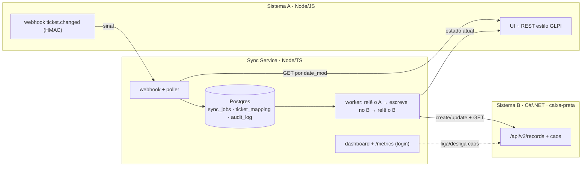

# Sincronizador de chamados

Mantém os chamados de um sistema estilo **GLPI (Sistema A)** sincronizados num **sistema externo instável e caixa-preta (Sistema B)**, sem nunca duplicar, perder ou sobrescrever com dado velho. Publicado e testado contra caos de propósito.

[](https://github.com/BossBurgues/desafiotecCyberCorp/actions/workflows/ci.yml)
[](https://github.com/BossBurgues/desafiotecCyberCorp/actions/workflows/deploy-prod.yml)

## Links

| | |
|---|---|
| **Sistema A** (mock GLPI, fonte da verdade) | https://a.150-230-231-210.sslip.io/ui/ |
| **Sistema B** (caixa-preta instável) | https://b.150-230-231-210.sslip.io/ui/ |
| **Dashboard do sync** (fila, DLQ, caos) | https://sync.150-230-231-210.sslip.io/dashboard |
| Saúde do sync | https://sync.150-230-231-210.sslip.io/ready |
| Vídeo da demo | _no e-mail da entrega_ |
| Backlog (Project) | https://github.com/users/BossBurgues/projects/2 |

As **credenciais de demonstração** (Técnico, Estagiário e dashboard) foram enviadas por e-mail junto com a entrega. Em produção elas são aleatórias e nunca entram no repositório.

## As três garantias e como cada uma é provada

| Nunca… | Mecanismo | Prova (roda em todo PR) |
|---|---|---|
| **duplicar** um chamado no B | Marcador `⟦s:glpi-<id>⟧` gravado no próprio registro. Create ambíguo (timeout, 500 depois de gravar) nunca é reenviado às cegas: o sync procura o marcador antes de recriar. Um job ativo por chamado, com lease | [`a1-commit-then-fail-nao-duplica`](tests/e2e/scenarios/a1-commit-then-fail-nao-duplica.test.js), [`a2-timeout-gravacao-tardia-nao-duplica`](tests/e2e/scenarios/a2-timeout-gravacao-tardia-nao-duplica.test.js), A4 e A6 (integração) |
| **perder** uma atualização | Evento gravado antes do 200; poller com sobreposição cobre webhook perdido; retry com backoff por até 24 h e DLQ reprocessável; **verificação pós-escrita** (o B pode responder 200 sem gravar) | [`b1-b-fora-jobs-esperam-e-drenam`](tests/e2e/scenarios/b1-b-fora-jobs-esperam-e-drenam.test.js), [`b2-webhook-perdido-poller-recupera`](tests/e2e/scenarios/b2-webhook-perdido-poller-recupera.test.js), [`b3-sync-cai-no-meio-do-job`](tests/e2e/scenarios/b3-sync-cai-no-meio-do-job.test.js), [`e4-b-lento-disjuntor`](tests/e2e/scenarios/e4-b-lento-disjuntor.test.js), B5 (integração) |
| **sobrescrever** dado novo com velho | O evento é só um sinal: o worker sempre relê o estado atual do A; um job por chamado | [`c1-eventos-fora-de-ordem`](tests/e2e/scenarios/c1-eventos-fora-de-ordem.test.js), [`b6-vinte-updates-terminam-no-ultimo`](tests/e2e/scenarios/b6-vinte-updates-terminam-no-ultimo.test.js), B10 (integração) |

Os 11 cenários E2E sobem os três sistemas de verdade, ligam o caos do B e derrubam containers ([`tests/e2e/README.md`](tests/e2e/README.md)). O passeio pelo código, com exercícios de quebra, está em [`docs/how-it-works.md`](docs/how-it-works.md).

## O opcional do avaliador: B → A leve

O avaliador deixou como opcional "o retorno de B para A (mudança de status, quem alterou, solução, fechamento e reabertura)" e pediu, se feito, para mostrar como uma atualização não fica indo e voltando e o que acontece quando os dois alteram o mesmo chamado ao mesmo tempo. Está feito numa versão leve ([ADR-014](docs/adr/014-b-para-a-leve.md)):

- O operador do B **resolve, fecha ou reabre**; em até 30 s o A recebe o status e uma nota com **quem alterou** e a **solução**.
- **Sem ida e volta:** o que o sync escreveu não conta como mudança do B (`last_written_hash`), o que o `sync-bot` escreveu no A não volta para o B, e nada é escrito se o outro lado já está igual. Prova: E2E [`f4-b-fecha-volta-ao-a-sem-eco`](tests/e2e/scenarios/f4-b-fecha-volta-ao-a-sem-eco.test.js).
- **Os dois ao mesmo tempo:** o A vence (é a fonte da verdade) e registra na conversa o que o B tinha feito. Edição de outros campos no B é desfeita pelo A. Antes de cada escrita o sync relê o B, então o A nunca reabre o que o B acabou de fechar.
- Sem aprovação do Técnico: a versão completa (o B propõe, o A aprova, congelamento) está desenhada no ADR-006.

## Arquitetura



Três linguagens de propósito: o sync só conversa por HTTP, pelos contratos de [`contracts/`](contracts/). Em produção, uma VM Oracle Always Free roda tudo com Docker Compose atrás do Caddy (HTTPS do Let's Encrypt). Detalhes em [`docs/architecture.md`](docs/architecture.md).

## Rodar local

Pré-requisitos: Docker com Compose e Node 20+.

```bash
cp .env.example .env
docker compose -f infra/docker-compose.yml --env-file .env up -d --build --wait
```

A em http://127.0.0.1:3001/ui/, B em http://127.0.0.1:5002/ui/, dashboard em http://127.0.0.1:3000/dashboard (usuário e senha no `.env`).

Os testes:

```bash
npm ci
npm test                 # unitários (A e sync); integração do sync com TEST_DATABASE_URL apontando para um Postgres
npm run test:b           # Sistema B (.NET)
docker compose -f infra/docker-compose.yml -f infra/docker-compose.e2e.yml --env-file .env.example up -d --build --wait
npm run e2e              # 11 cenários sob caos, ~4 min
```

## Demo de caos (para repetir na URL)

1. Entre no **dashboard** e, no painel **Caos do Sistema B**, ponha *erro 5xx (taxa)* em `0.5` e *grava e falha (taxa)* em `0.2`, e clique em **Aplicar**.
2. No **Sistema A**, como Técnico, crie e edite alguns chamados.
3. No dashboard, veja a fila crescer, os retries e o disjuntor abrir. A DLQ continua vazia.
4. Clique em **Desligar tudo**: a fila drena em segundos.
5. No **Sistema B**, confira: cada chamado aparece **uma vez**, com a última versão (o marcador `⟦s:glpi-<id>⟧` fica no fim da descrição).

## Decisões principais

- **O B é caixa-preta:** só assumimos criar, ler por ID, atualizar por ID e listar paginado ([ADR-003](docs/adr/003-contrato-minimo-do-b.md)).
- **Idempotência sem ajuda do B:** marcador no próprio dado + nunca reenviar create às cegas ([ADR-004](docs/adr/004-marcador-no-dado-e-teste-de-capacidade.md)).
- **O evento é só um sinal:** o worker relê o A; "mais novo" é decidido pelo hash dos campos sincronizáveis ([ADR-005](docs/adr/005-evento-e-sinal-date-mod-e-hash-utc.md)).
- **Fila no Postgres:** um job ativo por chamado, `SKIP LOCKED` + lease, sem broker extra ([ADR-002](docs/adr/002-fila-no-postgres-skip-locked.md)).
- **Transitório × permanente:** backoff por até 24 h, 3 recusas → DLQ, disjuntor ([ADR-008](docs/adr/008-transitorio-permanente-dlq-circuit-breaker.md)).

## Suposições

- **Quem trabalha o chamado:** o Técnico, no A (cria, edita, soluciona, fecha). O B é de um terceiro, com operador próprio; o que ele faz com o estado volta ao A (B → A leve).
- **Do B, só o contrato mínimo:** create, read por ID, update por ID e list paginado, sem idempotência, sem busca e sem garantia de ordem. Um campo de texto é devolvido como foi gravado (é onde vive o marcador).
- **O B pode mentir:** responder 200 sem gravar, gravar e responder 500, gravar depois do timeout, mudar o formato da resposta.
- **O A é a fonte da verdade** e segue o GLPI: sem campo de versão; "mais novo" vem do `date_mod` + hash.
- **O fuso do A é explícito** (`A_TIMEZONE`, `America/Sao_Paulo`); tudo é guardado em UTC. O relógio do B é ignorado.
- **Status e prioridade** são convertidos por tabela fixa ([`docs/field-mapping.md`](docs/field-mapping.md)); HTML vira texto seguro.

## O que ficou de fora

O avaliador confirmou que só o **A → B** é obrigatório; o B → A entrou na versão leve (acima). Ficaram de fora, com o desenho e a justificativa em [`docs/out-of-scope.md`](docs/out-of-scope.md):

- **B → A completo:** aprovação do Técnico, congelamento a partir do status 5 e exclusão em 2 passos ([ADR-006](docs/adr/006-b-propoe-a-aprova-congelamento-sla.md), [ADR-007](docs/adr/007-exclusao-em-2-passos.md)).
- Notas nos dois sentidos, anexos, SLA e mocks extras.
- Auditoria append-only com linha do tempo: os logs JSON com `correlation_id` e o `audit_log` técnico cobrem a demo.

## Horas

Registro por issue, por dia e por milestone em [`docs/timelog.md`](docs/timelog.md).

## Documentação

| Documento | Para quê |
|---|---|
| [`docs/how-it-works.md`](docs/how-it-works.md) | Passeio pelo código, garantias provadas e exercícios de quebra |
| [`docs/architecture.md`](docs/architecture.md) | Diagramas da arquitetura |
| [`docs/adr/`](docs/adr/) | Por que cada decisão foi tomada (14 ADRs) |
| [`docs/field-mapping.md`](docs/field-mapping.md) | Conversão campo a campo A → B |
| [`docs/runbook.md`](docs/runbook.md) | O que fazer quando algo foge do normal |
| [`docs/out-of-scope.md`](docs/out-of-scope.md) | O que ficou de fora e como seria feito |
| [`docs/timelog.md`](docs/timelog.md) | Horas |
| [`docs/PLANO_DE_ACAO.md`](docs/PLANO_DE_ACAO.md) | Plano completo e catálogo de cenários |
| [`infra/README.md`](infra/README.md) | Compose, VM, deploy e rollback |
| [`tests/e2e/README.md`](tests/e2e/README.md) | Como rodar e o que prova cada cenário |

## Uso de IA

O código e a documentação foram escritos com apoio de assistentes de IA, sob minha direção e revisão. Cada decisão está registrada nos ADRs, e eu sei explicar e alterar qualquer parte.
