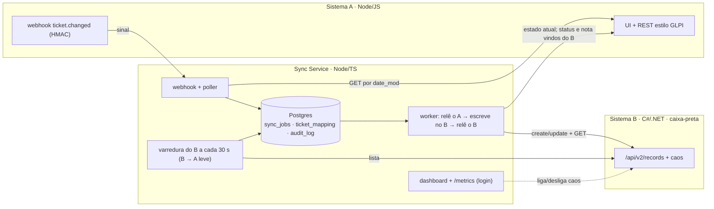

# Sincronizador de chamados

Mantém os chamados de um sistema estilo **GLPI (Sistema A)** sincronizados num **sistema externo instável e caixa-preta (Sistema B)**, sem nunca duplicar, perder ou sobrescrever com dado velho. Publicado e testado contra caos de propósito.

[](https://github.com/BossBurgues/desafiotecCyberCorp/actions/workflows/ci.yml)
[](https://github.com/BossBurgues/desafiotecCyberCorp/actions/workflows/deploy-prod.yml)

## Links

| | |
|---|---|
| **Sistema A** (mock GLPI, fonte da verdade) | https://a.150-230-231-210.sslip.io/ui/ |
| **Sistema B** (caixa-preta instável) | https://b.150-230-231-210.sslip.io/ui/ |
| **Dashboard do sync** (fila, DLQ, caos) | https://sync.150-230-231-210.sslip.io/dashboard |
| Saúde do sync | https://sync.150-230-231-210.sslip.io/ready |
| Backlog (Project) | https://github.com/users/BossBurgues/projects/2 |

As **credenciais de demonstração** (Técnico e Estagiário do A, código de convite para criar a conta no B e login do dashboard) foram enviadas por e-mail junto com a entrega. Em produção elas são aleatórias e nunca entram no repositório.

Também dá para criar contas na tela de entrada. No A, o cadastro cria um **Estagiário**, que abre e consulta chamados; para trabalhar o chamado, use o Técnico do e-mail. No B, criar conta exige o **código de convite**, e toda conta é de operador (o B não tem níveis).

## Entrega × o que o PDF pede

| O PDF pede | Onde está |
|---|---|
| Chamado criado ou atualizado no A aparece e fica atualizado no B | Sistema A → Sync → Sistema B, nas URLs acima |
| Sem duplicata, sem atualização perdida, sem dado velho sobre novo | [As três garantias](#as-três-garantias-e-como-cada-uma-é-provada), com 14 testes E2E sob caos em todo PR |
| O B lento e com erro, simulado | O caos do B, ligado pelo dashboard ([demo](#roteiro-da-demonstração)) |
| Repositório Git com o histórico | Este repositório; o resumo do histórico está em [`docs/historico.md`](docs/historico.md) |
| Documentação | [Documentação](#documentação) |
| Projeto publicado numa URL | [Links](#links) |
| Lista do que ficou de fora e por quê | [`docs/out-of-scope.md`](docs/out-of-scope.md) |
| Tempo gasto | [Horas](#horas) |
| Suposições anotadas no README | [Suposições](#suposições) |

## As três garantias e como cada uma é provada

| Nunca… | Mecanismo | Prova (roda em todo PR) |
|---|---|---|
| **duplicar** um chamado no B | Marcador `⟦s:glpi-<id>⟧` gravado no próprio registro. Create ambíguo (timeout, 500 depois de gravar) nunca é reenviado às cegas: o sync procura o marcador antes de recriar. Um job ativo por chamado, com lease. Se o banco do sync for perdido, na subida ele adota pelo marcador o que já está no B antes de criar qualquer coisa | [`a1-commit-then-fail-nao-duplica`](tests/e2e/scenarios/a1-commit-then-fail-nao-duplica.test.js), [`a2-timeout-gravacao-tardia-nao-duplica`](tests/e2e/scenarios/a2-timeout-gravacao-tardia-nao-duplica.test.js), A4 e A6 (integração), [`reconcile.test.ts`](apps/sync-service/test/integration/reconcile.test.ts) |
| **perder** uma atualização | Evento gravado antes do 200; poller com sobreposição cobre webhook perdido; retry com backoff por até 24 h e DLQ reprocessável; **verificação pós-escrita** (o B pode responder 200 sem gravar) | [`b1-b-fora-jobs-esperam-e-drenam`](tests/e2e/scenarios/b1-b-fora-jobs-esperam-e-drenam.test.js), [`b2-webhook-perdido-poller-recupera`](tests/e2e/scenarios/b2-webhook-perdido-poller-recupera.test.js), [`b3-sync-cai-no-meio-do-job`](tests/e2e/scenarios/b3-sync-cai-no-meio-do-job.test.js), [`e4-b-lento-disjuntor`](tests/e2e/scenarios/e4-b-lento-disjuntor.test.js), B5 (integração) |
| **sobrescrever** dado novo com velho | O evento é só um sinal: o worker sempre relê o estado atual do A; um job por chamado | [`c1-eventos-fora-de-ordem`](tests/e2e/scenarios/c1-eventos-fora-de-ordem.test.js), [`b6-vinte-updates-terminam-no-ultimo`](tests/e2e/scenarios/b6-vinte-updates-terminam-no-ultimo.test.js), B10 (integração) |

Os 14 testes E2E sobem os três sistemas de verdade, ligam o caos do B e derrubam containers ([`tests/e2e/README.md`](tests/e2e/README.md)). Além deles, rodam em todo PR 123 testes do A, 262 do sync (unitários e integração com Postgres) e 117 do B. O passeio pelo código, com exercícios de quebra, está em [`docs/how-it-works.md`](docs/how-it-works.md).

## O opcional do avaliador: B → A leve

O avaliador deixou como opcional "o retorno de B para A (mudança de status, quem alterou, solução, fechamento e reabertura)" e pediu, se feito, para mostrar como uma atualização não fica indo e voltando e o que acontece quando os dois alteram o mesmo chamado ao mesmo tempo. Está feito numa versão leve ([ADR-014](docs/adr/014-b-para-a-leve.md)):

- O operador do B **resolve, fecha ou reabre**; em até 30 s o A recebe o status e uma nota com **quem alterou** e a **solução**.
- **Sem ida e volta:** o que o sync escreveu não conta como mudança do B (`last_written_hash`), o que o `sync-bot` escreveu no A não volta para o B, e nada é escrito se o outro lado já está igual. Prova: E2E [`f4-b-fecha-volta-ao-a-sem-eco`](tests/e2e/scenarios/f4-b-fecha-volta-ao-a-sem-eco.test.js).
- **Os dois ao mesmo tempo:** o A vence (é a fonte da verdade) e registra na conversa o que o B tinha feito. Edição de outros campos no B é desfeita pelo A. Antes de cada escrita o sync relê o B, então o A nunca reabre o que o B acabou de fechar.
- Sem aprovação do Técnico: a versão completa (o B propõe, o A aprova, congelamento) está desenhada no ADR-006.
- **Exclusão nos dois lados** ([ADR-015](docs/adr/015-exclusao-nos-dois-lados-e-o-mestre.md)): excluir no A apaga no B e restaurar recria; o operador do B excluir leva o chamado para a **lixeira do A** com nota de quem excluiu, a não ser que o A tenha mudado o chamado depois (o A vence). O B guarda uma lápide (410), então "excluído" e "perdido" (404) não se confundem. Prova: E2E [`h1-exclusao-nos-dois-lados`](tests/e2e/scenarios/h1-exclusao-nos-dois-lados.test.js).

**Quem manda em cada mudança:** criar e campos → o A; status → quem mudou desde a última sincronização (os dois → o A); quem alterou e solução → o B (vira nota no A); excluir → o A decide (lixeira reversível). Tabela completa no ADR-015.

## Arquitetura



Três linguagens de propósito: o sync só conversa por HTTP, pelos contratos de [`contracts/`](contracts/). Em produção, uma VM Oracle Always Free roda tudo com Docker Compose atrás do Caddy (HTTPS do Let's Encrypt). Detalhes em [`docs/architecture.md`](docs/architecture.md).

## Rodar local

Pré-requisitos: Docker com Compose e Node 20+.

```bash
cp .env.example .env
docker compose -f infra/docker-compose.yml --env-file .env up -d --build --wait
```

A em http://127.0.0.1:3001/ui/ (usuários `tecnico` e `estagiario`, senhas `A_TECNICO_PASSWORD` e `A_ESTAGIARIO_PASSWORD` do `.env`), B em http://127.0.0.1:5002/ui/ (crie a conta na tela; localmente o convite fica vazio), dashboard em http://127.0.0.1:3000/dashboard (`DASHBOARD_USER` e `DASHBOARD_PASSWORD`).

Os testes:

```bash
npm ci
npm test                 # unitários (A e sync); integração do sync com TEST_DATABASE_URL apontando para um Postgres
npm run test:b           # Sistema B (.NET)
docker compose -f infra/docker-compose.yml -f infra/docker-compose.e2e.yml --env-file .env.example up -d --build --wait
npm run e2e              # 14 testes sob caos, ~4 min
```

## Roteiro da demonstração

Dá para repetir tudo nas URLs acima, com as credenciais do e-mail. O roteiro completo de 30 min, com plano B por bloco, está em [`docs/demo-script.md`](docs/demo-script.md).

**1. O caminho feliz (A → B).**
1. No **Sistema A**, como Técnico: **Novo chamado** → preencha e crie.
2. Em segundos, ele aparece no **Sistema B** uma vez, com o marcador `⟦s:glpi-<id>⟧` no fim da descrição.
3. No A: **Atribuir a mim** → escreva a solução → **Solucionar** → **Fechar**. O B acompanha no mesmo registro (`RESOLVED`, `CLOSED`).

**2. O B instável (as três garantias sob caos).**
1. No **dashboard**, painel **Caos do Sistema B**: *erro 5xx (taxa)* em `0.5` e *grava e falha (taxa)* em `0.2` → **Aplicar**.
2. No A, crie e edite vários chamados.
3. No dashboard: a fila cresce, os retries aparecem e o disjuntor abre. A DLQ continua vazia.
4. **Desligar tudo**: a fila drena em segundos. No B, cada chamado aparece **uma vez**, com a última versão.

**3. O opcional: B → A sem ida e volta.**
1. No B, abra um registro → **Fechar** com uma solução.
2. Em até 30 s, o A fica Fechado, com uma nota de quem alterou e da solução. Nenhum dos dois lados recebe escrita depois disso.
3. No B, mude o **título** → em 30 s o título volta e o A ganha a nota "o A é a fonte da verdade".

**4. Exclusão nos dois lados.**
1. No B, **Excluir** um registro → no A, o chamado vai para a lixeira, com a nota de quem excluiu.
2. No A, **Ver lixeira** → **Restaurar** → o registro volta ao B, sem duplicar.

Termine sempre com **Desligar tudo** no painel de caos: em produção o caos começa desligado.

## Decisões principais

- **O B é caixa-preta:** só assumimos criar, ler por ID, atualizar por ID e listar paginado ([ADR-003](docs/adr/003-contrato-minimo-do-b.md)).
- **Idempotência sem ajuda do B:** marcador no próprio dado + nunca reenviar create às cegas ([ADR-004](docs/adr/004-marcador-no-dado-e-teste-de-capacidade.md)).
- **O evento é só um sinal:** o worker relê o A; "mais novo" é decidido pelo hash dos campos sincronizáveis ([ADR-005](docs/adr/005-evento-e-sinal-date-mod-e-hash-utc.md)).
- **Fila no Postgres:** um job ativo por chamado, `SKIP LOCKED` + lease, sem broker extra ([ADR-002](docs/adr/002-fila-no-postgres-skip-locked.md)).
- **Transitório × permanente:** backoff por até 24 h, 3 recusas → DLQ, disjuntor ([ADR-008](docs/adr/008-transitorio-permanente-dlq-circuit-breaker.md)).

## Suposições

- **Quem trabalha o chamado:** o Técnico, no A (cria, edita, soluciona, fecha). O B é de um terceiro, com operador próprio; o que ele faz com o estado volta ao A (B → A leve).
- **Do B, só o contrato mínimo:** create, read por ID, update por ID e list paginado, sem idempotência, sem busca e sem garantia de ordem. Um campo de texto é devolvido como foi gravado (é onde vive o marcador).
- **O B pode mentir:** responder 200 sem gravar, gravar e responder 500, gravar depois do timeout, mudar o formato da resposta.
- **O A é a fonte da verdade** e segue o GLPI: sem campo de versão; "mais novo" vem do `date_mod` + hash.
- **O fuso do A é explícito** (`A_TIMEZONE`, `America/Sao_Paulo`); tudo é guardado em UTC. O relógio do B é ignorado.
- **Status e prioridade** são convertidos por tabela fixa ([`docs/field-mapping.md`](docs/field-mapping.md)); HTML vira texto seguro.

## O que ficou de fora

O avaliador confirmou que só o **A → B** é obrigatório; o B → A entrou na versão leve (acima). Ficaram de fora, com o desenho e a justificativa em [`docs/out-of-scope.md`](docs/out-of-scope.md):

- **B → A completo:** aprovação do Técnico e congelamento a partir do status 5 ([ADR-006](docs/adr/006-b-propoe-a-aprova-congelamento-sla.md)). A exclusão em 2 passos (ADR-007) foi substituída pela lixeira do A (ADR-015).
- Notas nos dois sentidos, anexos, SLA e mocks extras.
- Auditoria append-only com linha do tempo: os logs JSON com `correlation_id` e o `audit_log` técnico cobrem a demo.

## Horas

**Total: 29 h** (até 20/10), pelos registros do GitHub (commits, merges, PRs e issues; pausas acima de 1 h descontadas). Por dia e por issue em [`docs/timelog.md`](docs/timelog.md).

## Documentação

| Documento | Para quê |
|---|---|
| [`docs/how-it-works.md`](docs/how-it-works.md) | Passeio pelo código, garantias provadas e exercícios de quebra |
| [`docs/mapa-do-projeto.md`](docs/mapa-do-projeto.md) | Escopo, mapa mental, casos de uso de hoje e como seria a versão completa |
| [`docs/historico.md`](docs/historico.md) | Linha do tempo, épicos, stories, cenários, PRs e mudanças de rumo, pelos registros do GitHub |
| [`docs/glossario.md`](docs/glossario.md) | Siglas e termos do projeto (E2E, DLQ, caos, marcador…) |
| [`docs/architecture.md`](docs/architecture.md) | Diagramas da arquitetura |
| [`docs/adr/`](docs/adr/) | Por que cada decisão foi tomada (15 ADRs) |
| [`docs/field-mapping.md`](docs/field-mapping.md) | Conversão campo a campo A → B |
| [`docs/runbook.md`](docs/runbook.md) | O que fazer quando algo foge do normal |
| [`docs/out-of-scope.md`](docs/out-of-scope.md) | O que ficou de fora e como seria feito |
| [`docs/timelog.md`](docs/timelog.md) | Horas |
| [`docs/demo-script.md`](docs/demo-script.md) | Roteiro da apresentação de 30 min, com plano B por bloco |
| [`docs/PLANO_DE_ACAO.md`](docs/PLANO_DE_ACAO.md) | Plano completo e catálogo de cenários |
| [`infra/README.md`](infra/README.md) | Compose, VM, deploy e rollback |
| [`tests/e2e/README.md`](tests/e2e/README.md) | Como rodar e o que prova cada cenário |

## Uso de IA

O código e a documentação foram escritos com apoio de assistentes de IA, sob minha direção e revisão. Cada decisão está registrada nos ADRs, e eu sei explicar e alterar qualquer parte.
