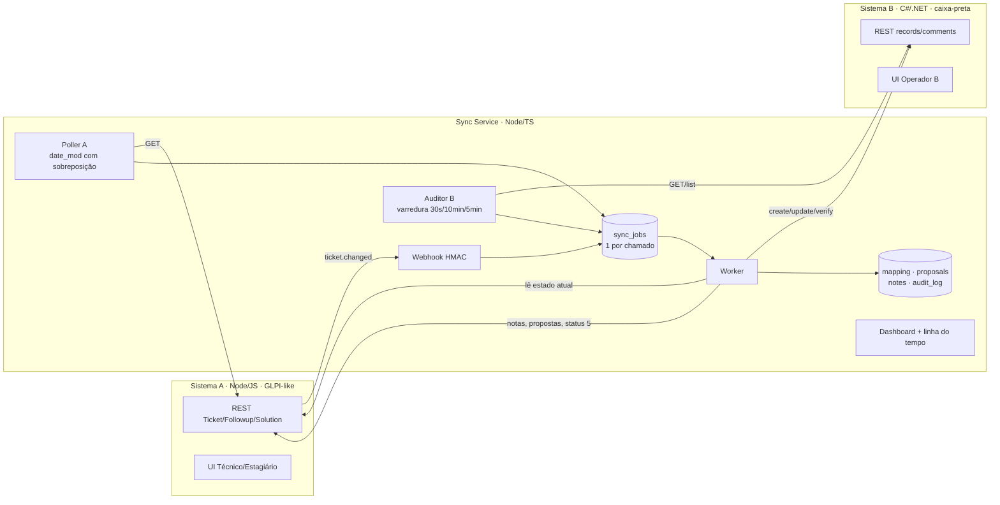
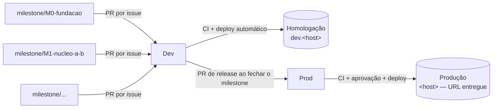

# Plano de Ação — Sincronizador de Chamados (Desafio CyberCorp)

- **Repositório:** https://github.com/BossBurgues/desafiotecCyberCorp
- **Board/Roadmap:** https://github.com/users/BossBurgues/projects/2
- **Desafio recebido:** 16/10/2026 · **Entrega-alvo:** 22/10/2026 · **Reserva:** 23/10/2026
- **Apresentação:** 30 min (demo + decisões + cenários)

> **Como usar este plano (pessoa ou LLM executora)**
> 1. Trabalhe **issue por issue** no GitHub, respeitando as dependências *blocked by*. Uma issue só começa quando todas as que a bloqueiam estão fechadas.
> 2. **Uma branch por milestone** (`milestone/M0-fundacao`, …). Cada atualização = commit pequeno (Conventional Commits) + push + PR para a `Dev` que fecha a issue (`Closes #n`). A `Dev` faz deploy em homologação; a `Prod` recebe um PR de release por milestone e faz deploy em produção. Ver seções 14.1 e 14.2.
> 3. Ao terminar cada issue: CI verde, `docs/how-it-works.md` atualizado e uma **explicação em linguagem simples** no PR (o que foi feito, por quê, como testar e qual garantia protege).
> 4. Ao terminar cada milestone, **pare e explique** antes de seguir.
> 5. Toda decisão abaixo foi tomada de propósito (sessão de *grilling*). Não mude nada sem registrar um ADR novo.

---

## 1. O desafio em uma frase

Toda criação ou atualização de chamado no **Sistema A** (estilo GLPI) precisa aparecer e ficar atualizada no **Sistema B** (outra API, outro formato, **não confiável**), entregue como se fosse para produção.

**As três proibições** (tudo neste plano existe para garanti-las):
1. ❌ Chamado duplicado no B (e, por extensão, nota duplicada em qualquer lado)
2. ❌ Atualização perdida
3. ❌ Dado antigo sobrescrevendo dado mais novo

> **Esclarecimento do avaliador (Ronaldo, 16/10):** o escopo **obrigatório é só A → B** (o B recebe e não devolve nada). O retorno **B → A** (mudança de status, quem alterou, solução, fechamento, reabertura) é **opcional**. Se for feito, ele quer ver **(1) como evitamos que uma atualização fique indo e voltando** e **(2) o que acontece quando os dois alteram o mesmo chamado ao mesmo tempo**.
> → **M0, M1, M2 e M5 são obrigatórios. M3 e M4 são opcionais** e são o primeiro corte se faltar tempo. As respostas aos dois pontos estão nas seções 5.1 e 5.2.

**Entregáveis pedidos:** repositório com histórico, documentação, projeto publicado em URL, lista do que ficou de fora e por quê, horas gastas, e outros itens julgados necessários.

---

## 2. Decisões consolidadas

| # | Tema | Decisão |
|---|---|---|
| Stack | Linguagens | **A:** Node.js + JavaScript · **B:** C# / .NET 8 · **Sync:** Node.js + TypeScript |
| Q1 | Detecção de mudanças no A | **Webhook + polling**. O polling é a garantia; o webhook é acelerador desligável (`A_WEBHOOK_ENABLED`) |
| Q2 | O que é "mais novo" | `date_mod` (estilo GLPI, sem campo de versão inventado) + **hash dos campos sincronizáveis**, agrupado por ID. O worker **sempre lê o estado atual do A** (o evento é só um sinal) |
| Q11 | Fuso | O fuso do A é explícito (`A_TIMEZONE`). Tudo é armazenado em UTC. O polling usa janela com sobreposição de 2 min. **O relógio do B é ignorado**: vale o horário em que nós observamos |
| Q11 | Geolocalização | Localização do chamado sincronizada (texto + coordenadas) + IP/origem das ações registrado na auditoria |
| Q3/Q8 | O que assumimos do B | **Nada além do contrato mínimo**: criar, ler por ID, atualizar por ID, listar (paginado, sem garantias) e um campo de texto devolvido como foi gravado |
| Q30/Q35 | Idempotência sem ajuda do B | **Marcador nosso no dado** (`⟦s:glpi-42⟧`) + mapeamento local + **nunca reenviar um create às cegas** + teste de capacidade na inicialização + regravar o marcador se for apagado |
| Q4/Q7 | Direção | O A é a fonte da verdade. **O B propõe, o A aprova** ("o estagiário executa, o diretor aprova") |
| Q19 | Classificação de mudanças do B | Resolver, excluir ou reabrir → **proposta**. Comentário → **nota no A**. Outros status → **informativo**. Edição de campo → **revertida + nota** |
| Q26 | Representar a proposta | Fiel ao GLPI: Solução pendente + **status 5 (Solucionado)** + `solvedate` = momento da detecção (UTC). Aprovar → 6 (Fechado). Recusar → 2 (Em atendimento) |
| Q17/Q18/Q27 | Congelamento | A partir do status 5, o chamado é **imutável: só aceita nota** (protege o SLA). Edição bloqueada → **409 + registro**, nunca silenciosa. O campo em proposta não é sobrescrito no B |
| Q28 | Congelamento × perda | O congelamento barra **escritas novas**, nunca a **entrega** do que o A já aceitou antes |
| Q18 | Propostas antigas | A proposta guarda `based_on_hash`. Se o A mudou o mesmo campo → **obsoleta (superseded)**. Proposta nova substitui a anterior |
| Q29 | Depois de fechado | Comentários do B viram nota "pós-fechamento" e não reabrem. Reabertura no B → **proposta** com aviso de impacto no SLA |
| Q5/Q9/Q20 | Exclusão | **2 passos**: o registro some do B → `deletion_requested` + nota no A → o Técnico aprova (A **fecha**, nunca exclui) ou recusa (**recria** no B, sem duplicar, e entrega o que estava retido) |
| Q12 | Quem/quando/por quê | Exclusão no A exige motivo. Para o B, registramos honestamente "autor/motivo não informado pelo B" |
| Q31/Q36 | Perfis | **Técnico:** tudo (inclusive aprovar). **Estagiário:** só ver e abrir chamado (sem notas). **sync-bot:** usuário técnico. **Operador B:** UI do B, sem papéis |
| Q21 | Conversa × log | O chamado no A mostra só **eventos de negócio** (estilo WhatsApp, com autor e horário). O `audit_log` técnico guarda tudo |
| Q22 | Anti-eco | `last_written_hash` por registro do B. Escritas do `sync-bot` não disparam sync. O hash ignora `date_mod`. Teste de estabilização |
| Q23 | Varredura do B | Ativos a cada 30 s, fechados a cada 10 min, listagem completa a cada 5 min. Concorrência limitada e desaceleração automática em 429/5xx |
| Q25 | Retry/DLQ | Backoff exponencial + jitter (até 5 min). **Erro transitório:** tenta por até 24 h. **Erro permanente (400/422):** 3 tentativas → DLQ. Circuit breaker. Reprocessar sempre relê o A |
| Q14 | Auditoria | `audit_log` **append-only** (sem UPDATE/DELETE no banco), `correlation_id`, segredos mascarados, retenção de 30 dias, linha do tempo por chamado |
| Q32 | Segurança | HMAC + timestamp no webhook, segredos só em GitHub Secrets/`.env`, dashboard e caos atrás de login, scans na CI |
| Q38 | Mocks extras | Caixa de saída de alertas, anexos (só metadados), tabela de-para de usuários/grupos/categorias, SLA (TTR/TTO) no A |
| Hosp. | Infra | VM **Oracle Always Free** + Docker Compose + Caddy (HTTPS). Imagens no GHCR. Plano B: Render + Neon |
| CI/CD | Pipeline | **GitHub Actions** (principal). GitLab como **mirror**. `milestone/*` → `Dev` (homologação) → `Prod` (produção), com promoção da mesma imagem (seção 14.2) |
| Q16/Q24 | Gestão | Milestones = camadas, épicos com sub-issues, stories com critérios de aceite, dependências *blocked by*, Roadmap no Project |

---

## 3. Estrutura de pastas

```
desafiotecCyberCorp/
├── apps/
│   ├── system-a/                    # Mock GLPI — Node.js (JavaScript)
│   │   ├── src/
│   │   │   ├── server.js            # API estilo GLPI (/apirest.php/Ticket, ITILFollowup, ITILSolution)
│   │   │   ├── auth.js              # Sessão + perfis (Técnico, Estagiário, sync-bot)
│   │   │   ├── tickets.js           # Regras: status 1–6, solvedate, congelamento (409)
│   │   │   ├── webhooks.js          # Disparo HMAC, modo "perder X%"
│   │   │   ├── sla.js               # Mock SLA (TTR/TTO)
│   │   │   ├── store.js             # SQLite
│   │   │   └── public/              # UI: login, lista, chamado com conversa, aprovações
│   │   ├── test/
│   │   └── Dockerfile
│   │
│   ├── system-b/                    # Caixa-preta instável — C# .NET 8
│   │   ├── src/SystemB.Api/
│   │   │   ├── Program.cs           # /api/v2/records, /comments (sem busca por ref, sem idempotência)
│   │   │   ├── Chaos/               # Latência, 5xx, timeout, commit-then-fail, ack-sem-gravar,
│   │   │   │                        # 200-com-erro, 429, truncar texto, paginação instável, drift de formato
│   │   │   ├── Admin/               # Apagar registro, wipe, configurar caos (protegido)
│   │   │   ├── Models/              # Formato próprio
│   │   │   ├── Storage/
│   │   │   └── wwwroot/             # UI do Operador B
│   │   ├── tests/SystemB.Tests/
│   │   └── Dockerfile
│   │
│   └── sync-service/                # ⭐ O que é avaliado — Node.js + TypeScript
│       ├── src/
│       │   ├── domain/              # PURO (sem I/O): mapper, hash, fuso, classificação, regras de proposta
│       │   ├── application/         # Casos de uso: processJob, detectBChanges, approve/reject, audit
│       │   ├── adapters/
│       │   │   ├── system-a/        # Cliente A + receptor de webhook
│       │   │   └── system-b/        # Cliente B: timeout, circuit breaker, validação de esquema, marcador
│       │   ├── infra/
│       │   │   ├── db/              # Migrations, repositórios
│       │   │   ├── queue/           # Worker SKIP LOCKED, lease, backoff, DLQ
│       │   │   ├── scheduler/       # Poller A, auditor/varredura B
│       │   │   └── http/            # Fastify: webhook, /health, /ready, /metrics, dashboard
│       │   ├── config.ts            # zod
│       │   └── main.ts
│       ├── migrations/
│       ├── test/{unit,integration}/
│       └── Dockerfile
│
├── contracts/                       # Independentes de linguagem
│   ├── system-a.openapi.yaml
│   ├── system-b.openapi.yaml        # Só o contrato mínimo + capacidades opcionais marcadas
│   └── events/ticket-changed.schema.json
├── tests/e2e/                       # Catálogo de cenários (seção 12) contra o compose inteiro
├── infra/
│   ├── docker-compose.yml
│   ├── docker-compose.e2e.yml
│   ├── caddy/Caddyfile
│   └── scripts/
├── docs/
│   ├── architecture.md              # Mermaid: componentes + sequências
│   ├── how-it-works.md              # Passeio guiado pelo código
│   ├── field-mapping.md
│   ├── adr/
│   ├── runbook.md
│   ├── out-of-scope.md
│   └── timelog.md
├── .github/{workflows,ISSUE_TEMPLATE,pull_request_template.md}
├── README.md
└── CONTRIBUTING.md
```

---

## 4. Arquitetura



### Fluxo A → B (núcleo)
1. Webhook ou poller → upsert em `sync_jobs` (um por chamado; repetições são aglutinadas).
2. Worker → **lê o chamado atual no A** → calcula o hash dos campos sincronizáveis.
3. Se o hash for igual a `last_synced_hash` → nada a fazer (idempotente).
4. Sem mapeamento → **create** com marcador. Ambíguo (timeout/5xx/200-com-erro) → `create_uncertain` → varre a listagem do B procurando o marcador → só recria depois de N varreduras sem achar.
5. Com mapeamento → **update** (exceto campo em proposta) → **verificação pós-escrita** (GET e comparação).
6. Atualiza o mapeamento de forma atômica + `audit_log` + `last_written_hash`.

### Fluxo B → A (proposta)
1. O auditor lê o registro do B → hash diferente de `last_written_hash` → a mudança é do B.
2. Classifica (Q19) → proposta, nota, informativo ou reversão.
3. Proposta de solução → Solução pendente no A + status 5 + `solvedate` (detecção UTC) + `based_on_hash` + nota do `sync-bot`.
4. O Técnico aprova (→ 6, B confirmado) ou recusa (→ 2, B revertido, nota com motivo nos dois lados).

### Fluxo de exclusão (2 passos)
O registro some → `deletion_requested` + nota no A ("autor/motivo não informado pelo B") → o Técnico aprova (A fechado, mapeamento arquivado) ou recusa (recria com marcador, novo ID do B guardado no histórico, entrega os updates retidos).

---

## 5. As garantias, mecanismo por mecanismo

| Proibição | Mecanismos |
|---|---|
| **Duplicata** | Um job por chamado (índice único parcial) · marcador `⟦s:…⟧` · `create_uncertain` + varredura · teste de capacidade (o marcador sobrevive no B?) com quarentena se falhar · `note_mapping` + `⟦n:…⟧` nas notas · `⟦from-b:…⟧` nos comentários B→A · recriação só depois de procurar o marcador |
| **Perda** | Webhook persistido antes do 200 · poller com sobreposição · retries de até 24 h · circuit breaker (espera sem gastar tentativas) · verificação pós-escrita · auditor anti-entropia · lease no worker · DLQ com alerta + reprocessamento que relê o A · edição bloqueada = 409 explícito · congelamento não barra entrega |
| **Antigo sobre novo** | O worker lê sempre o estado atual do A · hash + `date_mod` em UTC · um job por chamado (sem envios concorrentes) · relógio do B ignorado · `based_on_hash` e propostas obsoletas · edição de campo no B revertida · status em proposta não é sobrescrito |

### 5.1 Ida e volta (ping-pong) — pergunta do avaliador
- `last_written_hash`: se o que a varredura vê no B é exatamente o que nós escrevemos, não é mudança do B.
- Escritas do `sync-bot` no A não disparam sync A → B.
- O hash do A ignora `date_mod` (nota do sync não conta como mudança de dado).
- Uma decisão aplicada (aprovação/recusa) gera **uma** escrita em cada lado e para.
- **Prova:** cenários F1 (estabilização em 3 ciclos) e F4 (ping-pong: contador de escritas por chamado estável).

### 5.2 A e B alteram o mesmo chamado ao mesmo tempo — pergunta do avaliador
**Regra:** o A é a fonte da verdade, mas **nenhuma alteração do B some sem registro**.

| Situação | O que acontece |
|---|---|
| Mesmo campo nos dois lados (ex.: o A muda a prioridade e o B também) | O A vence. O valor do B é revertido + nota no A: "B alterou X para Y às …; prevaleceu o valor do A" |
| O A muda o status enquanto o B propõe "resolvido" | A proposta vira **obsoleta** (`based_on_hash` ≠ estado atual) + nota. O Técnico vê as duas coisas |
| Campos diferentes (o A muda a prioridade, o B resolve) | As duas são tratadas: a prioridade é entregue ao B e a resolução vira proposta (cenário B7) |
| **Janela de corrida:** o B edita no exato momento em que o sync faz o PUT | **Ler antes de escrever:** GET antes do PUT; se o B mudou desde `last_written_hash`, a mudança do B é classificada **antes** de escrever. Se o B oferecer **ETag**, o PUT usa `If-Match` → 412 → relê. Sem ETag, sobra uma janela de milissegundos entre o GET e o PUT: o **risco residual** fica documentado no ADR-011 (é impossível eliminar sem controle de concorrência no B) |
| "Quem alterou" | Capacidade opcional do B (`updatedBy`). Sem ela, a nota diz "não informado pelo B" |

**Prova:** cenários C7, C8, C9, D9 e F4.

---

## 6. Modelo de negócio e perfis

| Perfil | Ver | Abrir | Nota | Editar | Aprovar/recusar |
|---|---|---|---|---|---|
| Técnico (A) | ✅ | ✅ | ✅ | ✅ (exceto congelado) | ✅ |
| Estagiário (A) | ✅ | ✅ | ❌ | ❌ | ❌ |
| sync-bot (A) | ✅ | — | ✅ (notas de sistema) | só aplica decisões do A | ❌ |
| Operador B | UI do B: resolver, comentar, editar, excluir, reabrir (tudo vira proposta, nota ou reversão) |

Ação negada → **403** ou **409**, visível na UI e registrada no `audit_log`.

**Ciclo de vida no A (status GLPI):** 1 Novo · 2 Em atendimento · 3 Planejado · 4 Pendente · **5 Solucionado (congelado, aguardando aprovação)** · **6 Fechado (congelado)**.

---

## 7. Contrato mínimo do B e marcador

**Assumido (única suposição, ADR-003):** create, read por ID, update por ID, list paginado e um campo de texto devolvido como gravado.

**Não assumido:** busca por referência, `Idempotency-Key`, webhooks, timestamps confiáveis, autor da mudança, flag de excluído, listagem consistente, códigos HTTP coerentes, comentários (capacidade **opcional** `B_SUPPORTS_COMMENTS`; sem ela, as notas vão para um bloco "Histórico" no texto).

**Marcador:** curto e no fim do campo configurado (`B_MARKER_FIELD`).
- **Na inicialização:** o sync grava um registro de teste, relê e confere. Se o marcador não sobreviver → **modo seguro**: creates ambíguos vão para quarentena + alerta, nunca para recriação automática.
- **Marcador apagado por alguém do B** → o auditor detecta e regrava, com registro no `audit_log`.

O mock do B **não implementa** nada além do contrato mínimo + comentários, para provar que não há trapaça.

---

## 8. Modelo de dados (sync)

| Tabela | Campos principais |
|---|---|
| `inbound_events` | id, source (webhook/poll/scan), ticket_id, payload, received_at |
| `sync_jobs` | id, ticket_id, kind, status (pending/running/done/dead), attempts, next_run_at, locked_until, error_class (transient/permanent), last_error, first_failed_at |
| `ticket_mapping` | a_ticket_id PK, b_record_id UNIQUE, b_record_history[], state (active/create_uncertain/quarantine/deletion_requested/archived), last_synced_hash, last_written_hash, last_synced_date_mod_utc, last_verified_at, missing_since |
| `proposals` | id, a_ticket_id, kind (solve/delete/reopen), field, proposed_value, based_on_hash, status (pending/approved/rejected/superseded), decided_by, decided_at, reason |
| `note_mapping` | a_followup_id, b_comment_id, direction, marker, state |
| `audit_log` | id, occurred_at, ticket_id, direction, action, actor, correlation_id, request_summary, response_summary, latency_ms, outcome, origin_ip *(append-only)* |
| `poll_checkpoint` | source, last_date_mod_utc |
| `alerts_outbox` | id, kind, ticket_id, message, created_at (mock de e-mail) |

---

## 9. Conversão de campos (detalhar em `docs/field-mapping.md`)

| A (GLPI) | B | Regra |
|---|---|---|
| `id` | marcador `⟦s:glpi-<id>⟧` | no campo `B_MARKER_FIELD` |
| `name` | `title` | trim, máximo de 200 |
| `content` | `description` | HTML → texto seguro |
| `status` 1–6 | `state` OPEN/IN_PROGRESS/ON_HOLD/RESOLVED/CLOSED | tabela; 5 e 6 só via fluxo de aprovação |
| `priority` 1–6 | `severity` LOW/MEDIUM/HIGH/CRITICAL | 1–2 LOW, 3 MEDIUM, 4 HIGH, 5–6 CRITICAL |
| `itilcategories_id` | `category` | texto via tabela de-para (mock) |
| requerente/técnico | `requester`/`assignee` | nome/e-mail via de-para (mock) |
| `locations_id` | `location {name, lat, lng}` | opcional |
| `date_mod` (fuso do A) | `sourceUpdatedAt` | convertido para UTC |
| anexos | `attachments[] {name,size,sha256}` | só metadados (mock) |

---

## 10. Parâmetros operacionais (todos configuráveis)

| Parâmetro | Padrão |
|---|---|
| Poll do A | 10 s, sobreposição de 2 min |
| Varredura do B: ativos / fechados / listagem | 30 s / 10 min / 5 min |
| Concorrência máxima no B | 4 |
| Timeout por requisição ao B | 5 s |
| Backoff | 1 s × 2ⁿ + jitter, teto de 5 min |
| Erro transitório → DLQ | depois de 24 h |
| Erro permanente → DLQ | depois de 3 tentativas |
| Circuit breaker | abre depois de 5 falhas seguidas, meia-abertura depois de 30 s |
| Varreduras antes de recriar (create_uncertain) | 2 |
| Retenção do `audit_log` | 30 dias |
| Janela anti-replay do HMAC | 5 min |

---

## 11. Auditoria e conversa

- **Conversa do chamado (notas no A, autor `sync-bot` ou "Sistema B"):** "Sincronizado com o B (#B-981)", "B propôs: Resolvido", "Técnico X aprovou/recusou (motivo)", "B tentou alterar o título de '…' para '…'; revertido", "B comentou: …", "Exclusão solicitada pelo B", "Atenção: sincronização atrasada há 10 min" (uma vez só).
- **`audit_log`:** tudo (requisições, retries, varreduras, negações 403/409, HMAC inválido). Visível na **linha do tempo por chamado** no dashboard.
- Mesmo `correlation_id` nos dois níveis.

---

## 12. Catálogo de cenários (61)

Nível: **U** unitário · **I** integração · **E** E2E (CI) · **D** demo/manual.

**A. Duplicatas:** A1 commit-then-fail (E) · A2 timeout com gravação tardia (E) · A3 200 com corpo de erro (E) · A4 webhook repetido 5× (I) · A5 webhook + poll na mesma mudança (I) · A6 dois workers no mesmo chamado (I) · A7 listagem atrasada após create (E) · A8 nota A→B com timeout ambíguo (E) · A9 comentário B→A visto duas vezes (I) · A10 recriação após exclusão recusada (E)

**B. Perda:** B1 B fora por 1 h (E) · B2 webhook perdido (E) · B3 sync cai no meio do job (E) · B4 sync fora enquanto o A muda (E) · B5 ack sem gravar (E) · B6 20 updates em 1 s (E) · B7 update na fila + congelamento (E) · B8 updates durante exclusão pendente (E) · B9 Postgres reinicia (E) · B10 reprocessar da DLQ relê o A (I) · B11 fuso/horário de verão no poll (U+I) · B12 dois updates no mesmo segundo (I)

**C. Antigo sobre novo:** C1 eventos fora de ordem (E) · C2 retry atrasado depois de um job novo (I) · C3 proposta sobre versão antiga (E) · C4 duas propostas seguidas (E) · C5 edição de campo no B revertida (E) · C6 relógio do B errado (U) · C7 A e B no mesmo campo ao mesmo tempo (E) · C8 campos diferentes ao mesmo tempo (E) · C9 B edita durante a escrita do sync (I)

**D. Aprovação:** D1 resolve → aprova (E) · D2 resolve → recusa (E) · D3 edição em congelado → 409 (I) · D4 o B edita campo de congelado (E) · D5 reabertura de fechado (E) · D6 exclusão aprovada/recusada (E) · D7 Estagiário tenta aprovar/editar/notar → 403 (I) · D8 `solvedate` em UTC da detecção (U) · D9 autor da alteração no B (I)

**E. B hostil:** E1 drift de formato → DLQ permanente + alerta (I) · E2 o B remove o marcador → modo seguro (I) · E3 429 → desacelera (I) · E4 B lento → timeout + breaker (E) · E5 ID inconsistente na leitura (I) · E6 paginação instável (I) · E7 B fora por mais de 24 h → DLQ + nota (I)

**F. Eco:** F1 estabilização em 3 ciclos (E) · F2 nota do `sync-bot` não dispara sync (I) · F3 escrita própria não vira "mudança do B" (I) · F4 ping-pong A↔B (E)

**G. Dados:** G1 todos os valores de status/prioridade (U) · G2 HTML/script → texto seguro (U) · G3 emoji, acentos, 100 KB (U+I) · G4 obrigatório vazio → 422 → DLQ (I) · G5 localização com/sem coordenadas (U)

**H. Segurança/operação:** H1 HMAC inválido/replay (I) · H2 dashboard sem login → 401 (I) · H3 logs sem tokens (U) · H4 deploy com migration sem perder a fila (D) · H5 `/ready` falha sem Postgres e o worker pausa (I)

**Fora do catálogo de propósito:** carga massiva, falha de disco, partição de rede por dias, DoS (documentados em `out-of-scope.md`).

---

## 13. Mocks extras e fora do escopo

| Item | Tratamento |
|---|---|
| Alertas | **Simulado:** caixa de saída de e-mail no dashboard |
| Anexos | **Simulado:** só metadados (nome, tamanho, sha256) |
| Usuários/grupos/categorias | **Simulado:** tabela de-para estática |
| SLA | **Simulado:** TTR/TTO no A a partir da `solvedate` |
| Webhooks do B | Fora: contradiz o contrato mínimo |
| HA / multi-região | Fora: a infra grátis não permite; o desenho suporta (`SKIP LOCKED`) |
| Grafana/Loki | Fora: dashboard próprio + `/metrics` |
| Edição de campos pelo B com aprovação campo a campo | Fora: só o ciclo de vida passa por aprovação |

`docs/out-of-scope.md` marca os itens simulados como *"simulado: como seria em produção"* e os de fora com *"como eu faria"*.

---

## 14. Fluxo no GitHub

- **Milestones:** M0 Fundação (16/10) · M1 Núcleo A→B (19/10) · M2 Auditoria & Segurança (20/10) · M3 B→A Propostas — **opcional** (21/10) · M4 Notas & Mocks — **opcional** (21/10) · M5 Entrega (22/10).
- **Hierarquia:** Épico (issue-pai) → Stories (sub-issues) · Épico "Cenários" → 8 categorias → 61 cenários.
- **Dependências nativas *blocked by*:** fechar uma issue libera as próximas.
- **Labels:** `type:*` (epic/story/test/docs) · `app:*` (system-a/system-b/sync/infra/docs) · `guarantee:*` (no-dup/no-loss/no-stale) · `area:*` (approval/blackbox/echo/data/security/audit).
- **Story:** "Como [papel], quero [ação], para [valor]" + critérios de aceite + Definition of Done.
- **Definition of Done:** testes passando · CI verde · documentação/`how-it-works` atualizados · PR explicando o que foi feito, por quê, como testar e qual garantia protege · horas registradas no `timelog.md`.
- **Branches:** uma por milestone (ver 14.1). A `main` fica protegida e sempre pronta para deploy.
- **Project:** Status · Milestone · Priority · Size · Estimate · Start/Target date → views **Board** e **Roadmap**.

### 14.1 Fluxo de branches, PRs e ambientes (definido em 18/10)



**Branches de ambiente (protegidas, nunca recebem commit direto):**

| Branch | Papel | Recebe PR de | Ao receber merge |
|---|---|---|---|
| `Dev` | Integração e homologação. **Deve ser a branch padrão do repositório** (o `Closes #n` só fecha issues em PRs mergeados na branch padrão) | branches `milestone/*` | CI completo + **deploy automático em homologação** |
| `Prod` | Produção: é a URL entregue à banca | somente `Dev` (PR de release) | CI completo + **aprovação manual** (GitHub Environment `production`) + deploy em produção + smoke test |
| `main` | Legado da criação do repositório | — | Sugestão: depois de definir a `Dev` como branch padrão, manter a `main` congelada ou apagá-la, para não haver três linhas de integração |

**Uma branch de longa duração por milestone**, criada a partir da `Dev`:

| Milestone | Branch |
|---|---|
| M0 · Fundação | `milestone/M0-fundacao` |
| M1 · Núcleo A→B | `milestone/M1-nucleo-a-b` |
| M2 · Auditoria & Segurança | `milestone/M2-auditoria-seguranca` |
| M3 · B→A Propostas (opcional) | `milestone/M3-b-a-propostas` |
| M4 · Notas & Mocks (opcional) | `milestone/M4-notas-mocks` |
| M5 · Entrega | `milestone/M5-entrega` |

**Ciclo de cada atualização (uma issue por vez em cada branch):**
1. Pegar a próxima issue desbloqueada do milestone, na ordem de prioridade do backlog (Priority → dependências).
2. **Commits pequenos**, um conceito por commit, com `Refs #n` na mensagem.
3. **Push** da branch do milestone.
4. **PR da branch do milestone → `Dev`** com `Closes #n` e o template preenchido.
5. CI verde → merge na `Dev` → deploy automático em homologação → conferir em `dev.<host>`.
6. Atualizar a branch do milestone com a `Dev` (`git pull origin Dev`) e seguir para a próxima issue do mesmo milestone.
7. **Milestone fechado** → PR de release `Dev → Prod` (título `release: M<n> …`, listando as issues entregues) → aprovação → deploy em produção.

**Merge:** preferir **merge commit** (sem squash) nos PRs para a `Dev`, para preservar os commits pequenos no histórico, que é um entregável. O PR #135 foi mergeado com squash. É aceitável, mas os próximos devem seguir o padrão.

**Regras:**
- No máximo **3 branches de milestone ativas ao mesmo tempo** (o atual e os próximos desbloqueados pela prioridade).
- Um PR aberto por vez em cada branch. A próxima issue só começa depois do merge da anterior.
- A branch do milestone é apagada quando todas as issues dele estiverem fechadas.
- Os cenários de teste (épico E8) entram na branch do **milestone de cada cenário**.
- Exceção histórica: a S0.1 (#12) foi entregue no PR #135 (`feat/12-estrutura-monorepo` → `main`) antes desta regra. A `Dev` e a `Prod` nasceram desse merge, e a `milestone/M0-fundacao` nasce da `Dev`.

### 14.2 CI/CD por branch

| Workflow | Gatilho | O que faz |
|---|---|---|
| `ci.yml` | PR para `Dev` ou `Prod`; push em `milestone/*` | Detecção de mudanças por app (paths-filter) → lint/typecheck/testes de cada app alterado → integração com Postgres → E2E com o compose (caos ligado) → build das imagens |
| `deploy-dev.yml` | push na `Dev` (merge de PR) | Build + push no GHCR com tags `dev-<sha>` e `dev` → SSH na VM → `docker compose -p cybercorp-dev` com `.env.dev` → migrations → smoke test em `https://dev.<host>/health` |
| `deploy-prod.yml` | push na `Prod` (merge do PR de release) | Exige o Environment `production` (aprovação manual) → **promove a mesma imagem já testada em homologação** (retag `dev-<sha>` → `prod-<sha>` e `prod`, sem rebuild) → SSH → `docker compose -p cybercorp-prod` com `.env.prod` → migrations → smoke test em `https://<host>/health` |

**Dois ambientes na mesma VM Oracle** (cabem folgados no Always Free ARM):
- Projetos compose separados (`cybercorp-dev` e `cybercorp-prod`), cada um com **o seu Postgres, volumes e segredos**: homologação nunca toca dados de produção.
- Um único Caddy na frente roteia `dev.<host>` e `<host>` (HTTPS automático nos dois).
- Segredos por ambiente em **GitHub Environments** (`development`, `production`): `SSH_*`, `HMAC_SECRET`, credenciais do dashboard, `B_ADMIN_TOKEN`.
- Na homologação o caos do B pode ficar ligado o tempo todo. Na produção ele começa desligado e é ligado ao vivo na demo, pelo dashboard protegido.

**Proteções:**
- `Dev`: PR obrigatório + CI verde + branch atualizada.
- `Prod`: PR obrigatório **só a partir da `Dev`** + CI verde + aprovação no Environment `production`.
- Rollback: o `deploy-prod.yml` aceita `workflow_dispatch` com uma tag `prod-<sha>` anterior.

Issues afetadas: **S0.2** (CI esqueleto + proteções da `Dev`/`Prod`), **S4.2** (CI completo), **S4.3** (VM com dois ambientes) e **S4.4** (deploy dev/prod).

---

## 15. Cronograma

| Dia | Foco | Milestone |
|---|---|---|
| 16/10 (sex) | Planejamento ✅ · estrutura do repo · CI esqueleto · ADRs · contratos | M0 |
| 17/10 (sáb) | Sistema A (JS) + Sistema B (C#) com caos, perfis e UIs | M1 |
| 18/10 (dom) | Núcleo do sync: banco, fila, worker, adapter B, processJob, marcador | M1 |
| 19/10 (seg) | Poller, auditor, verificação pós-escrita, cenários A/B/C/E/G na CI, **deploy publicado** | M1 ✅ |
| 20/10 (ter) | Auditoria, linha do tempo, segurança · **checkpoint de corte** | M2 |
| 21/10 (qua) | Propostas, congelamento, exclusão em 2 passos, notas, mocks extras | M3 + M4 |
| 22/10 (qui) | Docs, out-of-scope, timelog, roteiro + vídeo da demo, **entrega** | M5 |
| 23/10 (sex) | Reserva | — |

**Regra de corte:** se a M1 não estiver verde e publicada no fim de 20/10, M3/M4 viram "desenho documentado + mock mínimo".

---

## 16. ADRs a escrever

| ADR | Título |
|---|---|
| 001 | Stack poliglota (A JS, B C#, Sync TS) e comunicação só por contratos |
| 002 | Fila no Postgres (`SKIP LOCKED`) em vez de broker |
| 003 | Contrato mínimo do B: a única suposição |
| 004 | Marcador no dado como idempotência + teste de capacidade |
| 005 | O evento é sinal: ler o estado atual do A; `date_mod` + hash em UTC |
| 006 | O B propõe, o A aprova; status 5 e congelamento × SLA |
| 007 | Exclusão em 2 passos; "excluído ou perdido" é decisão humana |
| 008 | Transitório × permanente; DLQ de 24 h; circuit breaker |
| 009 | Anti-eco (`last_written_hash`, `sync-bot`) |
| 011 | Concorrência A×B: o A vence, ler antes de escrever, If-Match opcional, risco residual |
| 010 | Hospedagem Oracle + Compose; plano B Render + Neon |

---

## 17. Roteiro da apresentação (30 min)

| Tempo | Bloco |
|---|---|
| 0–3 | Problema, as 3 proibições, diagrama |
| 3–12 | Demo: o Estagiário abre → aparece no B → o Técnico edita → o B resolve → proposta → aprova. Conversa do chamado |
| 12–20 | **Caos ao vivo:** 50% de erro + commit-then-fail → fila, breaker, recuperação → contagem no B prova zero duplicatas |
| 20–25 | Decisões e trade-offs (caixa-preta, marcador, aprovação, congelamento × SLA), CI com 61 cenários |
| 25–30 | Fora do escopo + perguntas |

Plano B: vídeo gravado do mesmo roteiro.

---

## 18. Para entender o código

1. Um conceito por commit/PR.
2. O domínio é puro (`sync-service/src/domain`): dá para ler e testar sem subir nada.
3. Comentários explicam o **porquê**.
4. Os nomes dos testes são frases.
5. `docs/how-it-works.md` acompanha o caminho de um chamado, arquivo por arquivo.
6. **Exercícios de quebra** (para se preparar para a banca):
   - Remover a busca pelo marcador → A1 falha (duplicata).
   - Remover a sobreposição do poll → B11 falha (perda).
   - Remover a checagem de `based_on_hash` → C3 falha (antigo sobre novo).
   - Remover o filtro do `sync-bot` → F1 falha (loop).

---

## 19. Checklist de entrega

- [ ] Repositório com histórico contínuo (Conventional Commits)
- [ ] README (rodar, URLs, suposições, horas) + docs + ADRs
- [ ] URL pública com HTTPS (A, B, dashboard)
- [ ] `out-of-scope.md` com justificativas
- [ ] `timelog.md`
- [ ] CI verde + deploy automático
- [ ] Vídeo de backup da demo
- [ ] E-mail com o link do repositório + a URL
