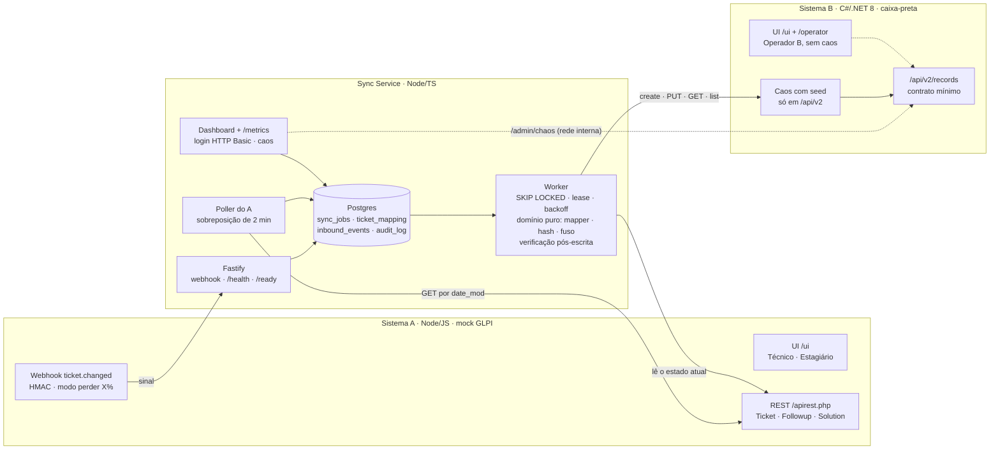
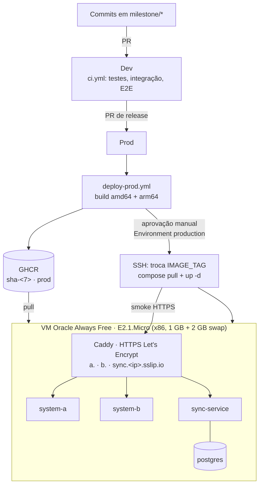
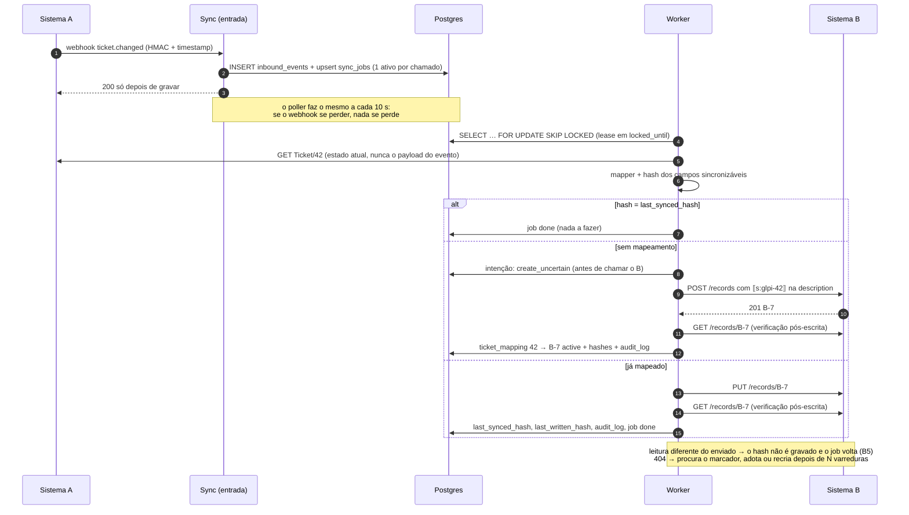
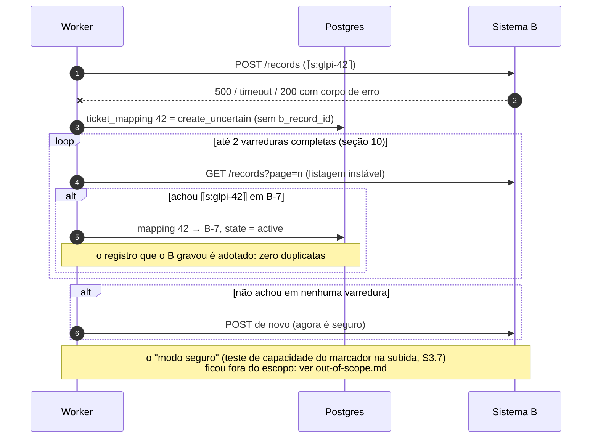
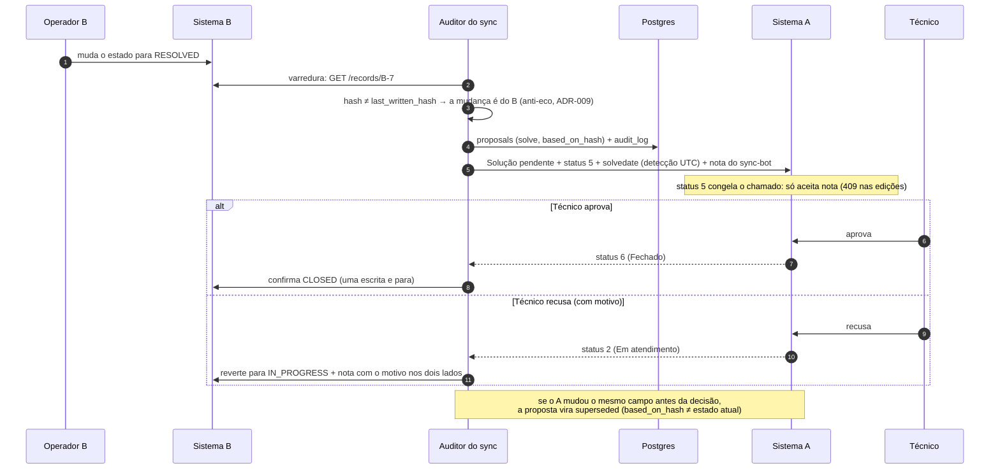
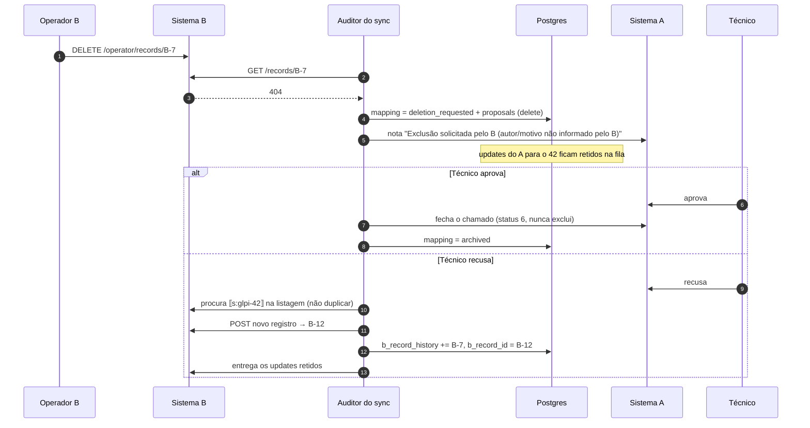
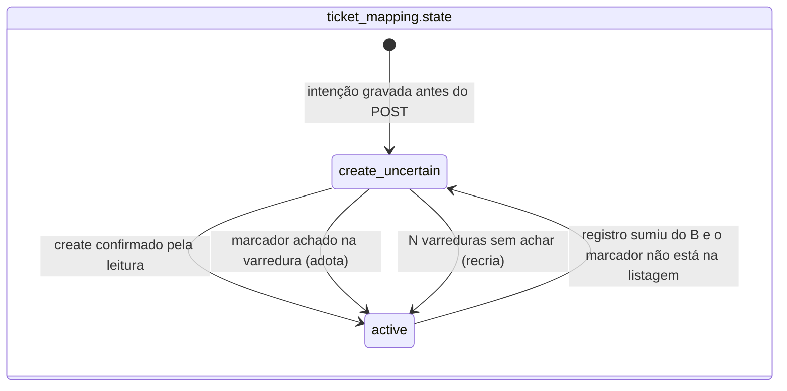
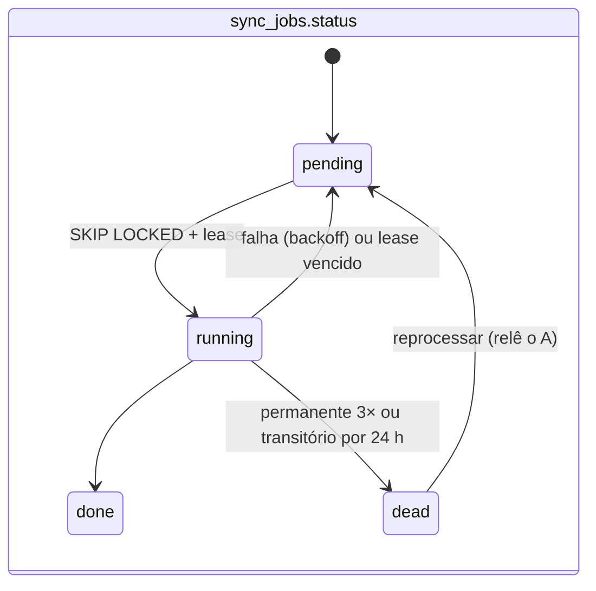

# Arquitetura

Visão rápida dos componentes e dos fluxos que sustentam as três garantias: **nenhuma duplicata**, **nenhuma atualização perdida** e **dado antigo nunca sobrescreve novo**. O porquê de cada decisão está nos [ADRs](adr/README.md); o passo a passo pelo código fica em [`how-it-works.md`](how-it-works.md). Revisado em 19/10 para o escopo entregue: o núcleo A → B. O B → A está aqui só como **desenho** (seções marcadas).

## Componentes

| Componente | Responsabilidade | Onde |
|---|---|---|
| Sistema A | Fonte da verdade. API estilo GLPI, perfis (Técnico, Estagiário, `sync-bot`), webhook assinado com modo "perder X%" | `apps/system-a` |
| Sistema B | Sistema externo em que **não confiamos**: só o contrato mínimo (ADR-003), formato próprio e caos reproduzível com seed | `apps/system-b` |
| Sync Service | Tudo o que é avaliado: entrada (webhook + poll), fila, worker, adaptadores, verificação pós-escrita, `audit_log` técnico e dashboard com login | `apps/sync-service` |
| Postgres | Fila e estado do sync na **mesma transação** (ADR-002) | serviço do compose |
| Contratos | OpenAPI do A e do B e schema do evento, independentes de linguagem | `contracts/` |

**Princípios que o desenho segue:**

- **O evento é só um sinal.** Webhook e poll só dizem "o chamado 42 mudou"; o worker sempre relê o A (ADR-005). Por isso eventos repetidos, atrasados ou fora de ordem não estragam nada.
- **Um job ativo por chamado.** Índice único parcial em `sync_jobs (ticket_id)` enquanto `pending`/`running`: repetições aglutinam e dois workers nunca escrevem o mesmo chamado ao mesmo tempo.
- **Idempotência sem ajuda do B.** Marcador `⟦s:glpi-<id>⟧` no texto + `ticket_mapping` + nunca reenviar um create às cegas (ADR-004).
- **Domínio puro.** Conversão, hash e fuso em `src/domain` sem I/O, com 100% de cobertura.

## Implantação

Um único ambiente (revisão de 18/10): a `Dev` só roda a CI e a `Prod` publica. Rollback: `workflow_dispatch` com uma tag `sha-<7>` anterior, sem rebuild. A VM ARM (A1.Flex) estava sem capacidade na região, então a Micro x86 entrou no lugar; as imagens saem para as duas arquiteturas. Plano B: Render + Neon (ADR-010, `infra/README.md`).

## Fluxo A → B (núcleo)

Falha **transitória** (timeout, 5xx, 429, rede) → backoff `1 s × 2ⁿ + jitter` até 5 min, por até 24 h. Falha **permanente** (400/422) → 3 tentativas e DLQ. Circuit breaker aberto → o job espera **sem gastar tentativas** (ADR-008).

## Falha ambígua no create (sem duplicar)

O B pode gravar e devolver erro, gravar e estourar o timeout, ou devolver 200 com corpo de erro (cenários A1, A2, A3). Reenviar o POST criaria um segundo registro.

## Fluxo B → A leve (implementado, ADR-014)

O operador do B resolve, fecha ou reabre; a varredura do B detecta pelo `last_written_hash`, o `processJob` compara com o `last_written_record`, aplica o status no A pelo `sync-bot` e escreve a nota com quem alterou e a solução. Se o A também mudou o estado, o A vence. Detalhe e diagrama em [`how-it-works.md`](how-it-works.md), seção 11.

## Fluxo B → A completo: proposta e aprovação (desenho, não implementado)

Escopo opcional do avaliador, fora da entrega (`out-of-scope.md`). O desenho responde às duas perguntas dele: anti-eco (ADR-009) e concorrência A × B (ADR-011). O A continua sendo a fonte da verdade: o B propõe, o A aprova (ADR-006).

## Exclusão em 2 passos (desenho, não implementado)

Na entrega, um registro que some do B é procurado pelo marcador e, se não aparecer, **recriado** (S3.8): o A é a fonte da verdade. O fluxo abaixo, com decisão humana, é o desenho para quando o B → A existir.

Para o sync, "excluído no B" e "perdido pelo B" parecem iguais (404). Quem decide é uma pessoa (ADR-007).

## Estados

Os estados `quarantine`, `deletion_requested` e `archived` existem no schema para o desenho do B → A, mas a entrega não os usa.

## Onde cada garantia mora

| Garantia | Mecanismos entregues | Cenários que provam |
|---|---|---|
| Nenhuma duplicata | Um job ativo por chamado · lock + lease no `claim` · marcador `⟦s:…⟧` · intenção `create_uncertain` antes do POST + varredura | A1, A2, A4, A6, B3 |
| Nenhuma perda | Webhook persistido antes do 200 · poller com sobreposição · retries até 24 h · disjuntor sem gastar tentativa · lease · verificação pós-escrita · DLQ que relê o A · `/ready` pausa o worker | B1, B2, B3, B5, B10, E4 |
| Antigo nunca sobre novo | Worker sempre relê o A · hash dos campos sincronizáveis + `date_mod` em UTC · um job por chamado · relógio do B ignorado | C1, B6, B10, B11 |
| Sem ping-pong (desenho) | `last_written_hash` já é gravado · escritas do `sync-bot` não disparariam sync · uma escrita por decisão | ADR-009 |

Testes por cenário: [`how-it-works.md`](how-it-works.md) seção 9 e [`tests/e2e/README.md`](../tests/e2e/README.md).
