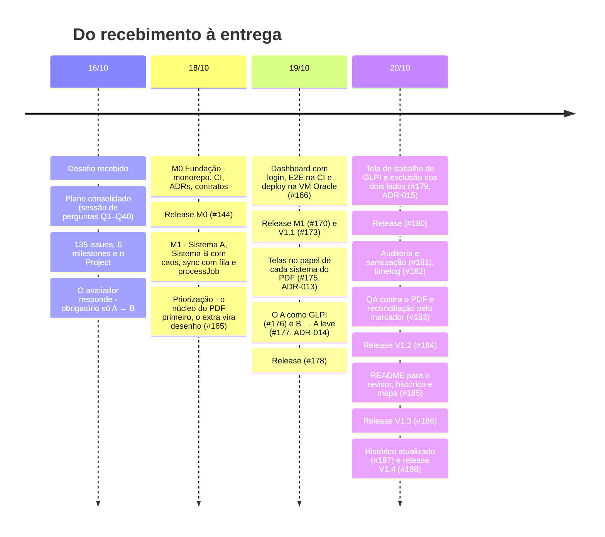

# Histórico do projeto

Tudo o que foi feito do recebimento do desafio (16/10/2026) até a entrega, montado a partir dos registros do GitHub: commits da `Dev`, PRs, issues, milestones e o [Project](https://github.com/users/BossBurgues/projects/2). As horas estão no [`timelog.md`](timelog.md). O mapa do que o sistema faz hoje está em [`mapa-do-projeto.md`](mapa-do-projeto.md), e as siglas e termos estão no [`glossario.md`](glossario.md).

## Em números

| | |
|---|---|
| Período | 16/10 (plano e backlog) a 20/10/2026 (código); números até o release V1.4 (#188) |
| Commits na `Dev` | 296: 218 em 18/10, 60 em 19/10, 18 em 20/10 |
| Pull requests | 53: 43 mergeados, 9 fechados de propósito (PRs de teste que provam que a CI barra o erro) e 1 refeito (#189) |
| Releases `Dev` → `Prod` | 8: #144, #170, #173, #178, #180, #184 (V1.2), #186 (V1.3) e #188 (V1.4) |
| Issues | 135: 10 épicos, 62 stories, 8 categorias de cenário e 55 cenários |
| Issues entregues | 73 (7 épicos, 35 stories, 6 categorias, 25 cenários) |
| Issues fora do escopo (*not planned*) | 62, com o desenho guardado nos ADRs e em [`out-of-scope.md`](out-of-scope.md) |
| ADRs | 15 ([`adr/`](adr/)) |
| Testes | 123 no A, 262 no sync (unitários e integração), 117 no B e 14 E2E sob caos |

## Como o escopo foi pensado

O plano de 16/10 foi feito **de propósito maior que o PDF**. Além do núcleo obrigatório (o A → B com as três garantias), ele mapeou o que um sincronizador de produção precisaria em seguida: o B → A completo com aprovação do Técnico, notas nos dois sentidos, auditoria append-only, SLA e um catálogo de 61 cenários de falha. Isso serviu para enxergar as melhorias possíveis e desenhar o núcleo sem fechar a porta para elas.

Com o prazo de 22/10, o que era extra foi priorizado para depois, em dois passos e sem nunca mexer no núcleo do PDF:

1. **18/10, priorização (#165):** tudo o que não prova uma das três garantias virou desenho documentado (ADRs e [`out-of-scope.md`](out-of-scope.md)) em vez de código.
2. **19/10, telas no papel de cada sistema (#175, [ADR-013](adr/013-pdf-como-base-a-central.md)):** as telas ainda tinham peças do desenho ampliado, como o B resolvendo e fechando no lugar do A. Elas foram ajustadas ao papel que o PDF dá a cada sistema: o A é o central e o B recebe.

Do que ficou para depois, voltou só o que responde às perguntas do avaliador: o B → A leve ([ADR-014](adr/014-b-para-a-leve.md)). As 62 issues fora do escopo estão fechadas como *not planned*, com o desenho guardado: são o roteiro das próximas melhorias.

## Linha do tempo



| Dia | O que aconteceu | Registro |
|---|---|---|
| **16/10** | Leitura do PDF, plano em [`PLANO_DE_ACAO.md`](PLANO_DE_ACAO.md), backlog no GitHub (épicos, stories, categorias e cenários com sub-issues e dependências) e pergunta ao avaliador. Resposta: o obrigatório é só o A → B; o B → A é opcional, e se for feito ele quer ver o anti-eco e a concorrência | Issues #2–#134 |
| **17/10** | Sem trabalho registrado | — |
| **18/10** | Fundação inteira e a maior parte do núcleo. Sistema A (API estilo GLPI, perfis, webhook com HMAC, UI), Sistema B em .NET com o caos, sync com domínio, fila no Postgres, adapter do B, processJob, webhook e poller. À noite, com o prazo à vista, a priorização: o escopo ampliado do plano (M2, M3 e M4) virou desenho documentado e o núcleo A → B do PDF ficou na frente | PRs #135–#165, release #144 |
| **19/10** | Dashboard com login, E2E na CI, deploy automático na VM Oracle com HTTPS, verificação pós-escrita, runbook e README. Depois, as telas foram ajustadas ao papel que o PDF dá a cada sistema, sem as peças do desenho ampliado: o A é o sistema central (soluciona e fecha) e o B recebe. Em seguida, o A ganhou cara de GLPI e o B → A leve voltou ao escopo para responder às duas perguntas do avaliador | PRs #166–#178, releases #170, #173, #178 |
| **20/10** | Tela de trabalho do GLPI no A, exclusão nos dois lados (lixeira do A e lápide do B), segurança dos cadastros, auditoria e sanitização do código, timelog. No fim do dia, o QA contra o PDF achou a duplicata após perda do banco do sync, corrigida no #183. À noite, o README virou a base para o revisor e entraram o histórico e o mapa do projeto | PRs #179–#187, releases #180, #184, #186, #188 |

## Como o trabalho foi organizado

- **Duas branches de longa duração.** A `Dev` é homologação: só roda a CI. A `Prod` é produção: cada merge dispara o deploy na VM ([ADR-010](adr/010-hospedagem-oracle-compose.md)). Um PR para a `Prod` que não venha da `Dev` é bloqueado (provado no PR de teste #137).
- **Uma branch por milestone** (`milestone/M<n>-…`), com um PR por issue ou por sprint para a `Dev`. Commits com `Refs #n` e `Closes #n` no corpo do PR.
- **PRs de prova da CI.** Os 9 PRs fechados sem merge (#137, #138, #139, #142, #146, #148, #151, #153, #156) quebram algo de propósito (teste, contrato, cobertura, `innerHTML`, permissão) para mostrar que a CI barra o erro.
- **Decisões viram ADR.** Nenhuma decisão do plano mudou sem um ADR novo (013, 014 e 015 nasceram das mudanças de rumo).

## Milestones

| Milestone | Para quê | Issues | Situação |
|---|---|---|---|
| **M0 · Fundação** | Monorepo, CI esqueleto, ADRs, contratos | 5 entregues | Fechado em 18/10 |
| **M1 · Núcleo A→B (3 garantias)** | Mocks A e B, sync A → B com as três garantias, CI com E2E, deploy | 69 | Fechado em 19/10 |
| **M2 · Auditoria & Segurança** | Auditoria append-only, linha do tempo, scans | 5, fora do escopo em 18/10 (desenho guardado) | O login do dashboard (S5.3) e o H2 foram para a M1 |
| **M3 · B→A Propostas & Aprovação** (opcional) | O B propõe, o A aprova, congelamento | 34, fora do escopo em 18/10 (desenho guardado) | Voltou em versão leve em 19/10 (ADR-014) |
| **M4 · Notas, Localização & Mocks** (opcional) | Notas nos dois sentidos, SLA, anexos | 13, fora do escopo em 18/10 | Desenho em `out-of-scope.md` |
| **M5 · Entrega** | Documentação, timelog, demo e e-mail de entrega | 13 entregues | Fechado em 20/10 |

## Épicos e stories

Legenda: ✅ entregue · ✂️ fora do escopo, com o desenho guardado (*not planned*) · ↩️ ficou para depois e voltou em versão menor.

### E0 · Fundação (#2) ✅

| Story | | PR |
|---|---|---|
| S0.1 Estrutura do monorepo, README, CONTRIBUTING e timelog (#12) | ✅ | #135 |
| S0.2 CI esqueleto com detecção de mudanças por app (#13) | ✅ | #136 |
| S0.3 ADRs 001–010 (#14) | ✅ | #140 |
| S0.4 Contratos OpenAPI do A e do B e schema do evento (#15) | ✅ | #143 |

### E1 · Sistema A, mock do GLPI em Node (#3) ✅

| Story | | PR |
|---|---|---|
| S1.1 API de chamados estilo GLPI (#16) | ✅ | #147 |
| S1.2 Perfis Técnico, Estagiário e sync-bot (#17) | ✅ | #149 |
| S1.3 Webhook `ticket.changed` com HMAC e "perder X%" (#18) | ✅ | #152 |
| S1.4 Acompanhamentos (ITILFollowup) (#19) | ↩️ | Notas do sync-bot no B → A leve (#177) e nota do Técnico na tela do A |
| S1.5 Soluções com aprovação e congelamento (#20) | ✂️ | Desenho no ADR-006 |
| S1.6 UI do Sistema A (#21) | ✅ | #157, refeita como tela de trabalho do GLPI em #176 e #179 |
| S1.7 Testes e Dockerfile do A (#22) | ✅ | #150 |

### E2 · Sistema B, caixa-preta instável em .NET (#4) ✅

| Story | | PR |
|---|---|---|
| S2.1 API de records com o contrato mínimo (#23) | ✅ | #155 |
| S2.2 Middleware de caos configurável e reproduzível (#24) | ✅ | #159 |
| S2.3 Comentários no B (#25) | ✂️ | — |
| S2.4 UI do operador do B (#26) | ✅ | #159 |
| S2.5 Admin do B: apagar, wipe, drift de formato (#27) | ✅ | #162 |
| S2.6 Testes xUnit e Dockerfile do B (#28) | ✅ | #159 |
| S2.7 Autor da alteração e ETag (#128) | ↩️ | O autor (`updatedBy`) entrou com o B → A leve (#177); o ETag/If-Match não |

### E3 · Sync, o núcleo A → B (#5) ✅

| Story | | PR |
|---|---|---|
| S3.1 Bootstrap: config, logs, health/ready, migrations (#29) | ✅ | #159 |
| S3.2 Domínio puro: mapper, hash, fuso (#30) | ✅ | #154 |
| S3.3 Fila: um job por chamado, `SKIP LOCKED`, lease, backoff, DLQ (#31) | ✅ | #162 |
| S3.4 Entrada: webhook HMAC + poller com sobreposição (#32) | ✅ | #163 |
| S3.5 Adapter do B: timeout, disjuntor, validação (#33) | ✅ | #162 |
| S3.6 processJob: create/update idempotente com marcador (#34) | ✅ | #163 |
| S3.7 Teste de capacidade do marcador e modo seguro (#35) | ✂️ | ADR-004 |
| S3.8 Verificação pós-escrita e registro sumido (#36) | ✅ | #167 |
| S3.9 Auditor anti-entropia (#37) | ↩️ | A varredura do B (#177) e a reconciliação pelo marcador na subida (#183) cobrem parte |
| S3.10 Dashboard: fila, DLQ, mapeamentos, caos (#38) | ✅ | #166, com fila e atividade reais em #181 |
| S5.3 Login no dashboard e proteção do caos (#46) | ✅ | #166 |

### E4 · Infra, CI/CD e deploy (#6) ✅

| Story | | PR |
|---|---|---|
| S4.1 Docker Compose (local = produção) + override E2E (#39) | ✅ | #162 |
| S4.2 Pipeline de CI completo (#40) | ✅ | #166 |
| S4.3 VM Oracle Always Free + Caddy HTTPS (#41) | ✅ | #166, #169 |
| S4.4 Deploy automático na Prod (GHCR + SSH + smoke + rollback) (#42) | ✅ | #166 |
| S4.5 Mirror no GitLab (#43) | ✂️ | ADR-012 (#161) |

### E5 · Auditoria e segurança (#7) ✂️

S5.1 `audit_log` append-only (#44), S5.2 linha do tempo por chamado (#45) e S5.4 scans na CI (#47) ficaram fora do escopo em 18/10, como desenho. Ficou um `audit_log` técnico (sem proteção append-only), mostrado como "atividade recente" no dashboard (#181).

### E6 · B → A completo: o B propõe, o A aprova (#8) ✂️ → ↩️ versão leve

As nove stories (S6.1–S6.9, #48–#55 e #129) ficaram fora do escopo em 18/10, como desenho. Em 19/10 voltou a parte que responde às perguntas do avaliador, sem aprovação ([ADR-014](adr/014-b-para-a-leve.md), #177):

| Desenho completo | O que existe hoje |
|---|---|
| S6.1 Detectar e classificar mudanças do B, com anti-eco | Varredura do B a cada 30 s com `last_written_hash` |
| S6.2–S6.4 Proposta de solução, aprovar ou recusar, propostas obsoletas | O estado do B vale direto no A, com nota; sem aprovação |
| S6.5 Exclusão em 2 passos | Substituída pela lixeira do A e pela lápide do B ([ADR-015](adr/015-exclusao-nos-dois-lados-e-o-mestre.md), #179) |
| S6.6 Reabertura como proposta | O B reabre e o A acompanha |
| S6.7 Reverter edição de campo feita no B | O A restaura o valor e registra uma nota |
| S6.8 Conversa do chamado e anti-eco no A | Notas do `sync-bot` com `⟦from-b:…⟧`; o que o sync-bot escreve não volta ao B |
| S6.9 Concorrência A×B, ler antes de escrever, If-Match | O A vence e registra o que o B tinha feito; o sync relê o B antes de escrever. Sem If-Match |

### E7 · Notas, localização e mocks extras (#9) ✂️

S7.1–S7.7 (#56–#62): notas nos dois sentidos, localização com coordenadas, caixa de alertas, anexos, de-para de usuários, SLA. A localização como texto entrou na conversão de campos do A como GLPI (#176).

### E8 · Cenários de teste do núcleo (#10) ✅

O catálogo do plano tinha 61 cenários em 8 categorias. Na priorização de 18/10, os do núcleo viraram testes e os demais ficaram como desenho:

| Categoria | Entregues | Fora do escopo | Onde são provados |
|---|---|---|---|
| A · Duplicatas (#71) | A1, A2, A4, A5, A6, A7 | A3, A8, A9, A10 | E2E `a1`, `a2`; integração do sync |
| B · Atualização perdida (#72) | B1, B2, B3, B5, B6, B10, B11, B12 | B4, B7, B8, B9 | E2E `b1`, `b2`, `b3`, `b6`; integração |
| C · Dado antigo sobre novo (#73) | C1, C6 | C2, C3, C4, C5, C7, C8, C9 | E2E `c1`; integração |
| D · Fluxo de aprovação (#74) | D7 | D1–D6, D8, D9 | Testes do A (permissões) |
| E · B hostil (#75) | E4 | — | E2E `e4` e o caos em todos os E2E |
| F · Eco e estabilidade (#76) | — (a categoria ficou para depois) | F1, F2, F3, F4 | O F4 voltou como E2E `f4` com o B → A leve |
| G · Dados e conversão (#77) | G1, G2, G3, G4 | G5 | E2E `g1`, `g2`; unitários do domínio |
| H · Segurança e operação (#78) | H1, H2, H5 | H3, H4 | Integração do webhook e do dashboard; E2E `h1` (exclusão) |

A lista de cada E2E está em [`tests/e2e/README.md`](../tests/e2e/README.md).

### E9 · Documentação e entrega (#11)

| Story | | PR |
|---|---|---|
| S9.1 README completo (#63) | ✅ | #171, #179, #185 |
| S9.2 `architecture.md` com Mermaid (#64) | ✅ | #160 |
| S9.3 `how-it-works.md` (#65) | ✅ | #171 |
| S9.4 `field-mapping.md` e `runbook.md` (#66) | ✅ | #154, #168 |
| S9.5 `out-of-scope.md` (#67) | ✅ | #160, #165 |
| S9.6 `timelog.md` final (#68) | ✅ | #179, #182 |
| S9.7 Roteiro da demo e vídeo de backup (#69) | ✂️ vídeo | O roteiro existe ([`demo-script.md`](demo-script.md)); o vídeo foi cancelado em 20/10 |
| S9.8 E-mail de entrega (#70) | ✅ | Enviado ao avaliador com o repositório, as URLs e os acessos |
| S9.9 Telas e docs no papel de cada sistema do PDF (#174) | ✅ | #175, #179 |

## Decisões de escopo

| Data | O que mudou | Por quê | Registro |
|---|---|---|---|
| 16/10 | O B → A passou a ser opcional | Resposta do avaliador por e-mail | [`out-of-scope.md`](out-of-scope.md) |
| 18/10 | O escopo ampliado (M2, M3 e M4) virou desenho documentado; o núcleo A → B do PDF ficou na frente, à prova de caos, publicado e documentado | O plano foi feito maior que o PDF para mapear melhorias; o prazo de 22/10 pediu priorizar | #165 |
| 18/10 | Sem mirror no GitLab | O pull mirror é pago; o PDF aceita GitHub | [ADR-012](adr/012-sem-mirror-no-gitlab.md) |
| 19/10 | Telas ajustadas ao papel de cada sistema no PDF: o A é o central e o B recebe | As telas ainda tinham peças do desenho ampliado ("o B propõe, o A aprova") | [ADR-013](adr/013-pdf-como-base-a-central.md), #175 |
| 19/10 | O B → A voltou em versão leve | Responder às duas perguntas do avaliador (eco e concorrência) | [ADR-014](adr/014-b-para-a-leve.md), #177 |
| 20/10 | Exclusão nos dois lados, com a lixeira do A no lugar dos 2 passos | Um caminho reversível e próximo do GLPI | [ADR-015](adr/015-exclusao-nos-dois-lados-e-o-mestre.md), #179 |
| 20/10 | Vídeo de backup cancelado | O plano B da demo é o compose local ou o E2E ao vivo | #69 |
| 20/10 | Reconciliação pelo marcador na subida do sync | O QA mostrou duplicatas no B depois de perder o banco do sync | #183 |

## Pull requests e releases

| PR | Data | O que entrou |
|---|---|---|
| #135 | 18/10 | Estrutura do monorepo (S0.1) |
| #136 | 18/10 | CI esqueleto com detecção por app (S0.2) |
| #140 | 18/10 | ADRs 001–011 (S0.3) |
| #141 | 18/10 | Rodada de QA por issue no fluxo |
| #143 | 18/10 | Contratos OpenAPI e schema do evento (S0.4) |
| **#144** | 18/10 | **Release M0 · Fundação** |
| #147 | 18/10 | API de chamados do A (S1.1) |
| #149 | 18/10 | Perfis do A (S1.2) |
| #150 | 18/10 | Testes, Dockerfile e CI do A (S1.7) |
| #152 | 18/10 | Webhook com HMAC (S1.3) |
| #154 | 18/10 | Domínio puro do sync (S3.2) |
| #155 | 18/10 | API de records do B (S2.1) |
| #157 | 18/10 | UI do A (S1.6) |
| #158 | 18/10 | Verificação enxuta no lugar da rodada de QA |
| #159 | 18/10 | Dockerfile do B, caos, UI do operador e bootstrap do sync (S2.6, S2.2, S2.4, S3.1) |
| #160 | 18/10 | `architecture.md` e `out-of-scope.md` (S9.2, S9.5) |
| #161 | 18/10 | ADR-012, sem mirror no GitLab |
| #162 | 18/10 | Fila no Postgres, adapter do B, admin do B e Compose (S3.3, S3.5, S2.5, S4.1) |
| #163 | 18/10 | processJob, webhook + poller, A6 e B10 (S3.6, S3.4) |
| #165 | 18/10 | Priorização do escopo: o núcleo do PDF primeiro, o extra como desenho |
| #166 | 19/10 | Dashboard, login, E2E na CI e deploy (S3.10, S5.3, S4.2–S4.4) |
| #167 | 19/10 | Verificação pós-escrita (S3.8) |
| #168 | 19/10 | Runbook (S9.4) |
| #169 | 19/10 | Caddy sem e-mail de ACME |
| **#170** | 19/10 | **Release M1 · Núcleo A→B** |
| #171 | 19/10 | `how-it-works.md` e README (S9.3, S9.1) |
| #172 | 19/10 | Fechar chamado no A e telas sem as peças do B → A completo |
| **#173** | 19/10 | **Release V1.1** |
| #175 | 19/10 | Telas e docs no papel de cada sistema do PDF (S9.9) |
| #176 | 19/10 | O A como GLPI: catálogos, datas, formulário, conversão de campos |
| #177 | 19/10 | B → A leve (ADR-014) |
| **#178** | 19/10 | **Release:** telas no papel de cada sistema, A como GLPI e B → A leve |
| #179 | 20/10 | Tela de trabalho do GLPI, exclusão nos dois lados (ADR-015), fechamento da M5 |
| **#180** | 20/10 | **Release:** A como GLPI, exclusão nos dois lados e segurança dos cadastros |
| #181 | 20/10 | Auditoria e sanitização (dashboard real, `GlpiError`, DRY) |
| #182 | 20/10 | Timelog final e vídeo cancelado |
| #183 | 20/10 | Reconciliação pelo marcador na subida do sync |
| **#184** | 20/10 | **Release V1.2:** auditoria e sanitização, timelog final e reconciliação pelo marcador |
| #185 | 20/10 | README para o revisor, `historico.md` e `mapa-do-projeto.md` |
| **#186** | 20/10 | **Release V1.3:** README para o revisor, histórico e mapa |
| #187 | 20/10 | Histórico com as releases V1.2 e V1.3 |
| **#188** | 20/10 | **Release V1.4:** histórico atualizado |

O #145 (`Prod` → `Dev`) só trouxe o merge da primeira release de volta para a `Dev`.

## Commits

| Tipo | Commits | | Escopo | Commits |
|---|---|---|---|---|
| `feat` | 92 | | `system-a` | 57 |
| `docs` | 83 | | `sync` | 46 |
| merges (PRs e sincronização de branches) | 48 | | `system-b` | 26 |
| `test` | 30 | | `infra` | 14 |
| `chore` | 17 | | `e2e` | 12 |
| `fix` | 16 | | `contracts` | 11 |
| `ci`, `refactor`, `build` | 9 | | `adr`, `ui`, `security` | 8 |

Primeiro commit: `0e55455`, em 18/10 às 08:41. Para ver tudo:

```bash
git log --reverse --format='%h %ad %s' --date=short origin/Dev
```
