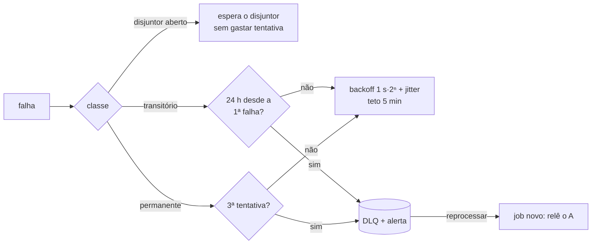
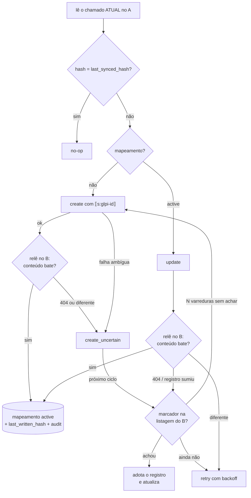

# Como funciona: passeio pelo código

Guia para ler o código na ordem em que um chamado viaja do A para o B. Cada seção diz **onde está** e **qual garantia protege** (seção 5 do plano). Vai crescendo a cada story.

## 1. Subir o ambiente

`infra/docker-compose.yml` sobe A, B, sync, Postgres e Caddy com o mesmo arquivo em local, CI e VM. O sync aplica as migrations na subida e só depende do Postgres: A ou B fora aparecem no `/ready`, e o worker pausa (não gasta tentativas). Detalhes em [`infra/README.md`](../infra/README.md).

## 2. Entrada: webhook + poller

Duas portas de entrada, as duas terminam em `enqueue` (S3.4):

- **Webhook** `POST /webhooks/system-a` (`src/infra/http/webhook.ts`). Confere `X-Signature-256 = sha256=HMAC(segredo, "<X-Timestamp>.<corpo cru>")` em tempo constante e recusa timestamp com mais de 5 min de diferença (**anti-replay**). O evento é gravado em `inbound_events` e o job é enfileirado **na mesma transação, antes do 200** (**perda**: se o sync cair depois de responder, o job já está no Postgres). O mesmo `event_id` entregue de novo é aceito e ignorado. Recusas vão para o `audit_log`.
- **Poller** (`src/application/poller.ts`), a rede de segurança para o webhook perdido (o A do E2E perde 30% de propósito). A cada 10 s pede ao A tudo com `date_mod >= checkpoint − 2 min`. A **sobreposição** cobre o commit atrasado e o relógio. O limite inferior é calculado com o menor offset do fuso na janela (horário de verão, `pollLowerBoundLocal`). O checkpoint só avança depois de enfileirar e nunca passa de agora. Chamado com o mesmo hash já sincronizado, ou com job pendente, não gera sinal novo. Comparar pelo hash cobre dois updates no mesmo segundo (B12).

## 3. Fila: um job por chamado

`apps/sync-service/src/infra/queue/queue.ts`, `enqueue(ticketId)`:

- O índice único parcial `sync_jobs_one_active_per_ticket` garante **um job ativo por chamado**. Dez eventos do mesmo chamado viram um job (**duplicata** e **antigo sobre novo**: nunca há dois envios concorrentes do mesmo chamado).
- O job **não guarda o conteúdo** do chamado, só o ID. O worker sempre lê o estado atual do A (ADR-005), então aglutinar não perde nada.
- Evento que chega **enquanto o job roda** marca `rerun`, e o job volta para a fila ao terminar (**perda**: a mudança feita depois da leitura não fica para trás).

## 4. Worker: pegar, processar, concluir ou falhar

`src/infra/queue/queue.ts` + `runner.ts`:

1. `claim` pega jobs vencidos com `FOR UPDATE SKIP LOCKED` e dá a cada um um **lease** (`locked_until` + `lease_token`).
2. `runOnce` chama o `processJob` (seção 5) e renova o lease a cada terço do prazo. Lease perdido aborta o processamento antes de escrever no B.
3. Sucesso → `complete`. Falha → `fail`, que decide entre nova tentativa e DLQ:

- Worker que caiu: o lease vence e outro worker retoma (**perda**). O worker antigo, se acordar, não consegue concluir nem falhar o job: o token não é mais dele.
- DLQ: `status = 'dead'` + `alerts_outbox`. `reprocessDead` cria um job novo, que relê o A (ADR-008, cenário B10).

## 5. processJob: o chamado chega ao B uma vez só

`src/application/process-job.ts` (S3.6, ADR-004):

- **Antigo sobre novo:** o job só tem o ID; o estado vem do A na hora (um job atrasado nunca escreve dado velho).
- **Duplicata:** create ambíguo (timeout, 5xx, 200 com erro: o B pode ter gravado) nunca é reenviado às cegas. O chamado fica em `create_uncertain` e o próximo ciclo procura o marcador em todas as páginas da listagem. Achou → adota. Só depois de `CREATE_UNCERTAIN_SCANS` (2) varreduras sem achar é que recria (a listagem do B pode estar atrasada, A7, ou pular página).
- **Perda por "ack sem gravar" (S3.8, B5):** depois de todo create e update o sync relê o registro no B (`VERIFY_AFTER_WRITE`, ligado por padrão) e compara o hash do conteúdo. Só então grava `last_synced_hash`. Se o B respondeu 200 sem gravar, o hash antigo fica, o job volta com backoff, relê o A e reenvia o estado atual. Sem isso o próximo evento viraria no-op e a atualização sumiria para sempre.
- **Registro sumiu do B (404):** o A é a fonte da verdade. O sync procura o marcador na listagem (o registro pode ter outro ID) e adota; não achou → `create_uncertain`, e recria só depois de N varreduras. Um 404 logo depois de um 201 também vira `create_uncertain`, porque pode ser gravação atrasada: recriar na hora arriscaria duplicata.
- **Atomicidade:** mapeamento, hashes e `audit_log` são gravados numa transação só. `last_written_hash` é o hash do que escrevemos no B: é a base do anti-eco (ADR-009).
- O sync fala com o A como **sync-bot** (`src/adapters/system-a/client.ts`, `user_token`), que só lê chamados e escreve notas. Sessão expirada (401) é reaberta uma vez.

## 6. Falar com o B

`src/adapters/system-b/` (ADR-003, ADR-008):

- `client.ts`: timeout de 5 s, validação de toda resposta 2xx com zod estrito, desaceleração em 429 e classificação de cada falha em `BError` (`errorClass`, `reason`, `ambiguous`, `retryAfterMs`).
- `circuit-breaker.ts`: 5 falhas seguidas → aberto 30 s → uma requisição de teste.
- "**B fora**" (timeout, rede, 5xx, 200 com erro) é transitório. "**B recusou**" (400/422, drift de formato) é permanente. `ambiguous = true` num create significa que o B pode ter gravado: nunca reenviar às cegas, procurar o marcador (ADR-004, S3.6).

## 7. Ver acontecer: dashboard

`src/infra/http/dashboard.ts` + `public/dashboard.html` (S3.10), em `http://localhost:3000/dashboard`. Mostra a fila por status, a DLQ com o motivo, os mapeamentos (`create_uncertain` aparece aqui), a caixa de saída de alertas e o disjuntor do B. O botão **Reprocessar** cria um job novo que relê o A (B10). O **painel de caos** repassa ao `/admin/chaos` do B pela rede interna. `/metrics` expõe os mesmos números para o Prometheus. Reprocessar e caos alteram o sistema: ficam desligados (`DASHBOARD_CONTROLS=false`) até o login do dashboard (S5.3).

## 8. O B hostil, para testar

`apps/system-b`: caos em `/api/v2` (`B_CHAOS_*` ou `PUT /admin/chaos`), drift de formato (`formatDrift`: `title` vira `summary`), `DELETE /admin/records/{id}` e `POST /admin/wipe` para simular perda (autocura pelo auditor, S3.9). Tudo atrás do `X-Admin-Token`. O override `infra/docker-compose.e2e.yml` liga o caos agressivo com seed fixa.
