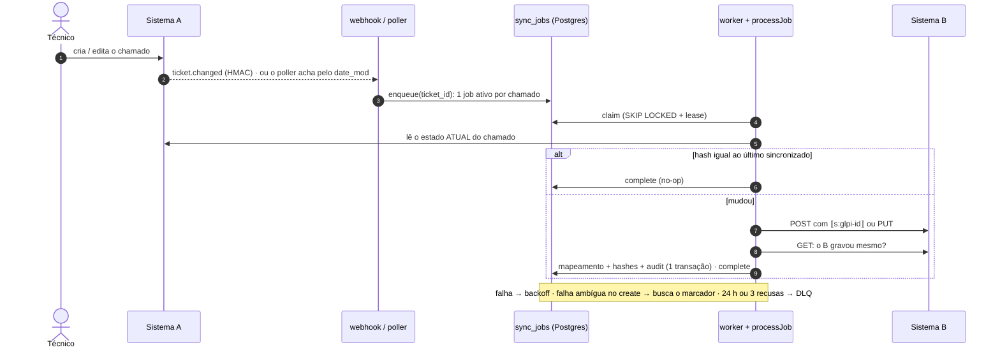
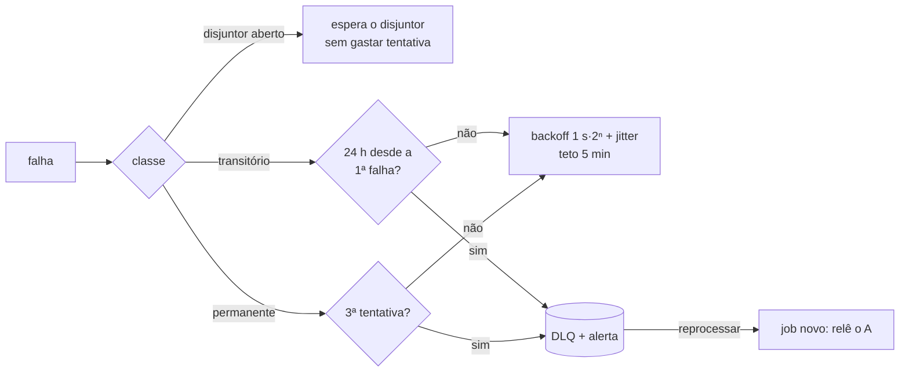
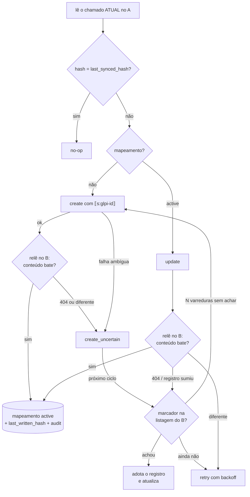
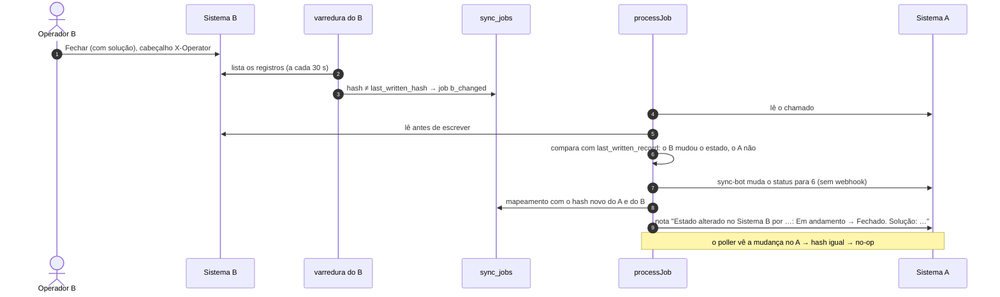

# Como funciona: passeio pelo código

Guia para ler o código na ordem em que um chamado viaja do A para o B. Cada seção diz **onde está** e **qual garantia protege**. Os links abrem a função citada. O retorno B → A está na versão leve (seção 11, [ADR-014](adr/014-b-para-a-leve.md)); o desenho completo, com aprovação, está nos ADRs [006](adr/006-b-propoe-a-aprova-congelamento-sla.md), [007](adr/007-exclusao-em-2-passos.md), [009](adr/009-anti-eco.md) e [011](adr/011-concorrencia-a-x-b.md) e no [`out-of-scope.md`](out-of-scope.md), que respondem às duas perguntas do avaliador (anti-eco e concorrência A × B).

As três garantias: **sem duplicata** (um chamado vira um registro no B), **sem perda** (toda mudança do A chega) e **sem dado velho** (uma versão antiga nunca sobrescreve uma nova).

## 0. O caminho de um chamado em 60 segundos

O Técnico salva o chamado no A. O A avisa o sync por webhook assinado. Se o aviso se perder, o poller acha a mudança alguns segundos depois. Os dois só enfileiram o **ID** do chamado: um job por chamado. Um worker pega o job com lease, **relê o chamado no A**, compara o hash com o último sincronizado e escreve no B: create com o marcador `⟦s:glpi-<id>⟧` no texto ou update. Depois **relê o registro no B** para confirmar que gravou de verdade. Só então grava o mapeamento, os hashes e a auditoria, numa transação só. Qualquer falha devolve o job à fila com backoff. O que não se resolve vai para a DLQ, de onde é reprocessado relendo o A.

## 1. Subir o ambiente

`infra/docker-compose.yml` sobe A, B, sync, Postgres e Caddy com o mesmo arquivo em local, CI e VM. O sync aplica as migrations na subida e só depende do Postgres: A ou B fora aparecem no `/ready`, e o worker pausa (não gasta tentativas). Detalhes em [`infra/README.md`](../infra/README.md).

## 2. Entrada: webhook + poller

Duas portas de entrada, as duas terminam em `enqueue` (S3.4):

- **Webhook** `POST /webhooks/system-a` ([`webhookPlugin`](../apps/sync-service/src/infra/http/webhook.ts#L51)). [`verifySignature`](../apps/sync-service/src/infra/http/webhook.ts#L16) confere `X-Signature-256 = sha256=HMAC(segredo, "<X-Timestamp>.<corpo cru>")` em tempo constante e recusa timestamp com mais de 5 min de diferença (**anti-replay**, H1). O evento é gravado em `inbound_events` e o job é enfileirado **na mesma transação, antes do 200** (**perda**: se o sync cair depois de responder, o job já está no Postgres). O mesmo `event_id` entregue de novo é aceito e ignorado (A4). Recusas vão para o `audit_log`.
- **Poller** ([`pollOnce`](../apps/sync-service/src/application/poller.ts#L34)), a rede de segurança para o webhook perdido (B2). A cada 10 s pede ao A tudo com `date_mod >= checkpoint − 2 min`. A **sobreposição** cobre o commit atrasado e o relógio. O limite inferior usa o menor offset do fuso na janela (horário de verão, B11). O checkpoint só avança depois de enfileirar e nunca passa de agora. Chamado com o mesmo hash já sincronizado, ou com job pendente, não gera sinal novo. Comparar pelo hash cobre dois updates no mesmo segundo.

## 3. Fila: um job por chamado

[`enqueue`](../apps/sync-service/src/infra/queue/queue.ts#L38):

- O índice único parcial `sync_jobs_one_active_per_ticket` garante **um job ativo por chamado**. Dez eventos do mesmo chamado viram um job (**duplicata** e **dado velho**: nunca há dois envios concorrentes do mesmo chamado).
- O job **não guarda o conteúdo** do chamado, só o ID. O worker sempre lê o estado atual do A (ADR-005), então aglutinar não perde nada.
- Evento que chega **enquanto o job roda** marca `rerun`, e o job volta para a fila ao terminar (**perda**: a mudança feita depois da leitura não fica para trás).

## 4. Worker: pegar, processar, concluir ou falhar

[`queue.ts`](../apps/sync-service/src/infra/queue/queue.ts) + [`runner.ts`](../apps/sync-service/src/infra/queue/runner.ts):

1. [`claim`](../apps/sync-service/src/infra/queue/queue.ts#L55) pega jobs vencidos com `FOR UPDATE SKIP LOCKED` e dá a cada um um **lease** (`locked_until` + `lease_token`). Quem impede dois workers no mesmo job é o lock da linha com o `WHERE` reavaliado (só `pending` vencido ou `running` com **lease vencido**); o `SKIP LOCKED` evita que o segundo worker fique esperando (ver exercício 3).
2. [`runOnce`](../apps/sync-service/src/infra/queue/runner.ts#L34) chama o `processJob` (seção 5) e renova o lease a cada terço do prazo. Lease perdido aborta o processamento antes de escrever no B.
3. Sucesso → [`complete`](../apps/sync-service/src/infra/queue/queue.ts#L92). Falha → [`fail`](../apps/sync-service/src/infra/queue/queue.ts#L110), que decide entre nova tentativa e DLQ:

- Worker que caiu: o lease vence e outro worker retoma (**perda**, B3). O worker antigo, se acordar, não consegue concluir nem falhar o job: o token não é mais dele.
- DLQ: `status = 'dead'` + `alerts_outbox`. [`reprocessDead`](../apps/sync-service/src/infra/queue/queue.ts#L178) cria um job novo, que relê o A (ADR-008, B10).

## 5. processJob: o chamado chega ao B uma vez só

[`createProcessJob`](../apps/sync-service/src/application/process-job.ts#L123) (S3.6 e S3.8, ADR-004):

- **Dado velho:** o job só tem o ID; o estado vem do A na hora (um job atrasado nunca escreve dado velho, C1).
- **Duplicata:** create ambíguo (timeout, 5xx, 200 com erro: o B pode ter gravado) nunca é reenviado às cegas ([`create`](../apps/sync-service/src/application/process-job.ts#L438)). O chamado fica em `create_uncertain` e o próximo ciclo procura o marcador em todas as páginas da listagem ([`scanForMarker`](../apps/sync-service/src/application/process-job.ts#L515)). Achou → [`adopt`](../apps/sync-service/src/application/process-job.ts#L525). Só depois de `CREATE_UNCERTAIN_SCANS` (2) varreduras sem achar é que recria (A1, A2).
- **Perda por "ack sem gravar" (S3.8, B5):** depois de todo create e update o sync relê o registro no B ([`verify`](../apps/sync-service/src/application/process-job.ts#L420), `VERIFY_AFTER_WRITE` ligado por padrão) e compara o hash do conteúdo. Só então grava `last_synced_hash`. Se o B respondeu 200 sem gravar, o hash antigo fica, o job volta com backoff, relê o A e reenvia o estado atual. Sem isso o próximo evento viraria no-op e a atualização sumiria para sempre.
- **Registro sumiu do B (404):** o A é a fonte da verdade. [`recordMissing`](../apps/sync-service/src/application/process-job.ts#L378) procura o marcador na listagem (o registro pode ter outro ID) e adota; não achou → `create_uncertain`, e recria só depois de N varreduras. Um 404 logo depois de um 201 também vira `create_uncertain`, porque pode ser gravação atrasada.
- **Atomicidade:** [`saveActive`](../apps/sync-service/src/application/process-job.ts#L563) grava mapeamento, hashes e `audit_log` numa transação só. `last_written_hash` é o hash do que escrevemos no B: seria a base do anti-eco no B → A (ADR-009).
- O sync fala com o A como **sync-bot** (`src/adapters/system-a/client.ts`, `user_token`), que só lê chamados e escreve notas. Sessão expirada (401) é reaberta uma vez.
- A conversão de campos (status, prioridade, HTML → texto, fuso → UTC) é domínio puro: [`mapTicketToRecord`](../apps/sync-service/src/domain/mapper.ts#L50), [`hashTicket`](../apps/sync-service/src/domain/hash.ts#L59) e [`hashRecord`](../apps/sync-service/src/domain/hash.ts#L78). Tabela completa em [`field-mapping.md`](field-mapping.md).

## 6. Falar com o B

`src/adapters/system-b/` (ADR-003, ADR-008):

- [`createSystemBClient`](../apps/sync-service/src/adapters/system-b/client.ts#L55): timeout de 5 s, validação de toda resposta 2xx com zod estrito, desaceleração em 429 e classificação de cada falha em `BError` (`errorClass`, `reason`, `ambiguous`, `retryAfterMs`).
- [`createCircuitBreaker`](../apps/sync-service/src/adapters/system-b/circuit-breaker.ts#L18): 5 falhas seguidas → aberto 30 s → uma requisição de teste (E4).
- "**B fora**" (timeout, rede, 5xx, 200 com erro) é transitório. "**B recusou**" (400/422, drift de formato) é permanente. `ambiguous = true` num create significa que o B pode ter gravado: nunca reenviar às cegas, procurar o marcador.

## 7. Ver acontecer: dashboard e caos

[`dashboardPlugin`](../apps/sync-service/src/infra/http/dashboard.ts#L113) + `public/dashboard.html` (S3.10), em `https://sync.<DOMAIN>/dashboard`:

- Fila por status, DLQ com o motivo, mapeamentos (`create_uncertain` aparece aqui), caixa de saída de alertas e o disjuntor do B, atualizando a cada 2 s. `/metrics` expõe os mesmos números para o Prometheus.
- **Reprocessar** cria um job novo que relê o A (B10). O **painel de caos** repassa ao `/admin/chaos` do B pela rede interna, com o `X-Admin-Token`. Pela internet, o Caddy responde 404 para o `/admin` do B.
- **Login (S5.3, H2):** a página, a API e o `/metrics` pedem HTTP Basic ([`checkBasicAuth`](../apps/sync-service/src/infra/http/dashboard.ts#L29), comparação em tempo constante). Sem `DASHBOARD_USER` e `DASHBOARD_PASSWORD` o dashboard nem é registrado. Toda ação de controle loga o usuário.

## 8. O B hostil, para testar

`apps/system-b`: caos em `/api/v2` (`B_CHAOS_*` ou `PUT /admin/chaos`): latência, 5xx, timeout com gravação tardia, grava e falha, ack sem gravar, 200 com corpo de erro, 429, texto truncado, listagem que repete ou pula página e drift de formato (`title` vira `summary`). `/health`, `/operator` e a UI ficam fora do caos. O override `infra/docker-compose.e2e.yml` liga o caos agressivo com seed fixa.

## 9. Como as três garantias são provadas

Testes de integração com Postgres de verdade e A/B em memória (`apps/sync-service/test/integration`) e E2E contra o compose completo com o caos ligado (`tests/e2e/scenarios`). Tudo roda em todo PR (CI: jobs `sync-service` e `e2e`).

| Garantia | Mecanismo | Onde | Teste |
|---|---|---|---|
| Sem duplicata | marcador `⟦s:glpi-id⟧` + `create_uncertain` + N varreduras | `create`, `scanForMarker`, `adopt` | I: "B grava e responde 500 (commit-then-fail)…" · E: `a1-commit-then-fail-nao-duplica`, `a2-timeout-gravacao-tardia-nao-duplica` |
| Sem duplicata | um job ativo por chamado + lock com lease | `enqueue`, `claim` | I: A6 em `scenarios.test.ts` · A4 em `inbound.test.ts` |
| Sem perda | evento persistido antes do 200 + poller com sobreposição | `webhookPlugin`, `pollOnce` | I: `inbound.test.ts` · E: `b2-webhook-perdido-poller-recupera` |
| Sem perda | lease vencido é retomado; disjuntor espera sem gastar tentativa | `claim`, `fail` | E: `b3-sync-cai-no-meio-do-job`, `b1-b-fora-jobs-esperam-e-drenam`, `e4-b-lento-disjuntor` |
| Sem perda | verificação pós-escrita | `verify`, `recordMissing` | I: "B5: no retry depois do ack sem gravar…" e o bloco "verificação pós-escrita (S3.8)" |
| Sem dado velho | o job só tem o ID; o worker relê o A | `createProcessJob` | I: "lê o estado atual do A…" · E: `c1-eventos-fora-de-ordem`, `b6-vinte-updates-terminam-no-ultimo` · I: B10 |
| Sem ida e volta (B → A) | `last_written_hash` + `sync-bot` não dispara webhook + nenhuma escrita se o outro lado já está igual | `scanOnce`, `reconcile` | I: "(1) sem ida e volta…" em `b-to-a.test.ts` · E: `f4-b-fecha-volta-ao-a-sem-eco` |
| A × B ao mesmo tempo | ler antes de escrever; o A vence; nota no A | `update`, `reconcile` | I: "(2) A e B mudam o estado ao mesmo tempo…" em `b-to-a.test.ts` |
| Segurança | HMAC + anti-replay; login do dashboard | `verifySignature`, `checkBasicAuth` | I: H1 em `inbound.test.ts`, H2 em `dashboard.test.ts` |

## 10. Exercícios de quebra

Para se preparar para a banca: aplicar a quebra, rodar `TEST_DATABASE_URL=… npx vitest run <arquivo>` em `apps/sync-service`, ver o teste citado falhar e desfazer com `git checkout -- src`. Todos foram executados em 19/10.

| # | Quebra | O que falha | Lição |
|---|---|---|---|
| 1 | `scanForMarker` devolve `null` logo no início | 7 testes do `process-job.test.ts`: commit-then-fail, listagem atrasada, drift, sync morre entre o create e o mapeamento, create ambíguo adotado, registro sumido adotado, e o do runner | Sem procurar o marcador, todo create ambíguo vira **duplicata** |
| 2 | `verify` devolve `'ok'` sem ler o B | B5 em `scenarios.test.ts` + 5 testes da S3.8 | Um B que mente faz a atualização **sumir**: o hash é gravado e o próximo evento vira no-op |
| 3 | No `claim`, aceitar `status = 'running'` **sem** `locked_until < now()` | A6 (dez chamados, quatro workers), "workers concorrentes nunca pegam o mesmo job" e "lease vencido…" | O lease é o que impede dois workers no mesmo job. Curiosidade: tirar só o `SKIP LOCKED` **não** quebra nada, porque o Postgres reavalia o `WHERE` depois do lock; o `SKIP LOCKED` só evita que o segundo worker espere |
| 4 | Apagar a checagem de janela em `verifySignature` | "timestamp fora da janela de 5 min (replay) → 401…" (H1) | Sem o timestamp na janela, um evento capturado pode ser reenviado |
| 5 | Tirar o `signal.throwIfAborted()` do início do `create` | "lease perdido antes de escrever: não chama o B" | Um worker que perdeu o lease ainda escreveria no B junto com o novo dono |
| 6 | `checkBasicAuth` sempre aceita | os dois testes de 401 do H2 | Qualquer um ligaria o caos no meio da demo |

## 11. B → A leve: o estado mudado no B volta ao A

O opcional do avaliador ([ADR-014](adr/014-b-para-a-leve.md)). O operador do B resolve, fecha ou reabre; o A recebe o status e uma nota com quem alterou e a solução.

- **Varredura** ([`scanOnce`](../apps/sync-service/src/application/b-scanner.ts#L29)): para cada registro mapeado cujo hash não é o que o sync escreveu, enfileira um job `b_changed` na mesma fila do A → B (lease, retry, DLQ e auditoria valem igual).
- **Ler antes de escrever** ([`update`](../apps/sync-service/src/application/process-job.ts#L210)): todo update relê o B antes do PUT. Uma edição no A nunca reabre o que o B acabou de fechar, mesmo antes da varredura.
- **O que fazer com cada mudança** ([`reconcile`](../apps/sync-service/src/application/process-job.ts#L294)), comparando o B atual com o `last_written_record`:
  - estado mudado só no B → vale o do B (o `sync-bot` aplica no A e escreve a nota);
  - estado mudado nos dois lados → **o A vence**, nota no A dizendo o que o B tinha feito;
  - outro campo mudado no B → o A restaura, com nota.
- **Anti-eco:** (1) o que o sync escreveu tem o hash do `last_written_hash` e não vira job; (2) o A não manda webhook para escritas do `sync-bot`, e o mapeamento já tem o hash novo do A, então o evento do poller vira no-op; (3) se o B já está igual ao que seria escrito, não há PUT; (4) a nota vai depois de o mapeamento ser gravado, então não duplica se o job repetir.
- **Risco residual:** o B mudar entre o GET e o PUT (milissegundos). Sem ETag no mock; com `If-Match`, o PUT receberia 412 e releria (ADR-011). A próxima varredura corrige.
- `B_TO_A_ENABLED=false` desliga a varredura e a aplicação no A; o update continua lendo o B antes e não desfaz o estado que o B mudou.
