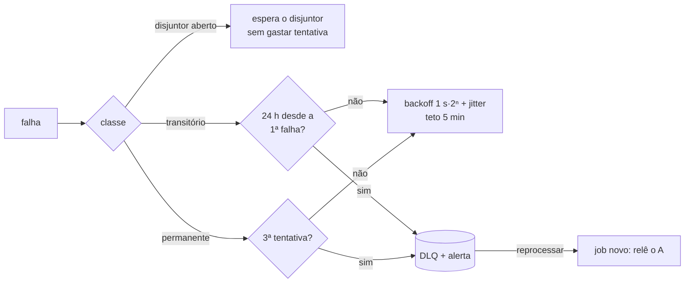

# Como funciona: passeio pelo código

Guia para ler o código na ordem em que um chamado viaja do A para o B. Cada seção diz **onde está** e **qual garantia protege** (seção 5 do plano). Vai crescendo a cada story.

## 1. Subir o ambiente

`infra/docker-compose.yml` sobe A, B, sync, Postgres e Caddy com o mesmo arquivo em local, CI e VM. O sync aplica as migrations na subida e só depende do Postgres: A ou B fora aparecem no `/ready`, e o worker pausa (não gasta tentativas). Detalhes em [`infra/README.md`](../infra/README.md).

## 2. Entrada: um job por chamado

> Webhook e poller (S3.4, #32) ainda vão chamar `enqueue`.

`apps/sync-service/src/infra/queue/queue.ts`, `enqueue(ticketId)`:

- O índice único parcial `sync_jobs_one_active_per_ticket` garante **um job ativo por chamado**. Dez eventos do mesmo chamado viram um job (**duplicata** e **antigo sobre novo**: nunca há dois envios concorrentes do mesmo chamado).
- O job **não guarda o conteúdo** do chamado, só o ID. O worker sempre lê o estado atual do A (ADR-005), então aglutinar não perde nada.
- Evento que chega **enquanto o job roda** marca `rerun`, e o job volta para a fila ao terminar (**perda**: a mudança feita depois da leitura não fica para trás).

## 3. Worker: pegar, processar, concluir ou falhar

`src/infra/queue/queue.ts` + `runner.ts`:

1. `claim` pega jobs vencidos com `FOR UPDATE SKIP LOCKED` e dá a cada um um **lease** (`locked_until` + `lease_token`).
2. `runOnce` chama o processador (o `processJob` entra na S3.6, #34) e renova o lease a cada terço do prazo.
3. Sucesso → `complete`. Falha → `fail`, que decide entre nova tentativa e DLQ:

- Worker que caiu: o lease vence e outro worker retoma (**perda**). O worker antigo, se acordar, não consegue concluir nem falhar o job: o token não é mais dele.
- DLQ: `status = 'dead'` + `alerts_outbox`. `reprocessDead` cria um job novo, que relê o A (ADR-008, cenário B10).

## 4. Falar com o B

`src/adapters/system-b/` (ADR-003, ADR-008):

- `client.ts`: timeout de 5 s, validação de toda resposta 2xx com zod estrito, desaceleração em 429 e classificação de cada falha em `BError` (`errorClass`, `reason`, `ambiguous`, `retryAfterMs`).
- `circuit-breaker.ts`: 5 falhas seguidas → aberto 30 s → uma requisição de teste.
- "**B fora**" (timeout, rede, 5xx, 200 com erro) é transitório. "**B recusou**" (400/422, drift de formato) é permanente. `ambiguous = true` num create significa que o B pode ter gravado: nunca reenviar às cegas, procurar o marcador (ADR-004, S3.6).

## 5. O B hostil, para testar

`apps/system-b`: caos em `/api/v2` (`B_CHAOS_*` ou `PUT /admin/chaos`), drift de formato (`formatDrift`: `title` vira `summary`), `DELETE /admin/records/{id}` e `POST /admin/wipe` para simular perda (autocura pelo auditor, S3.9). Tudo atrás do `X-Admin-Token`. O override `infra/docker-compose.e2e.yml` liga o caos agressivo com seed fixa.
