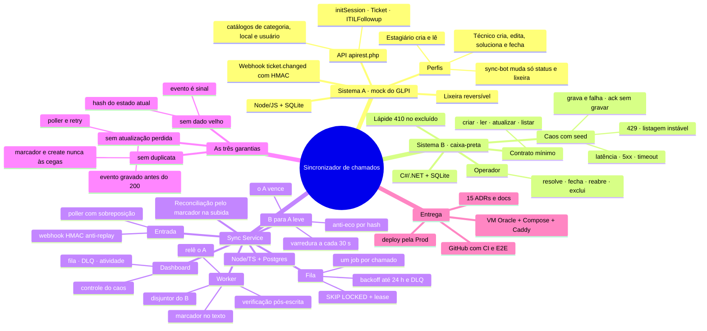
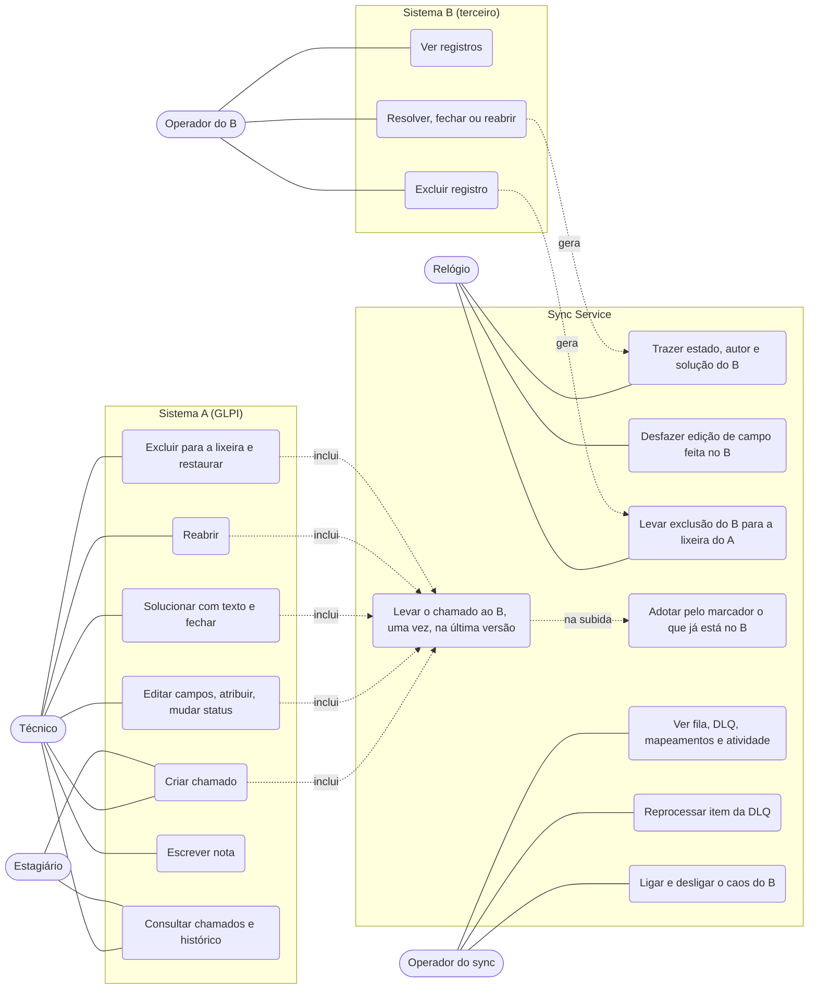
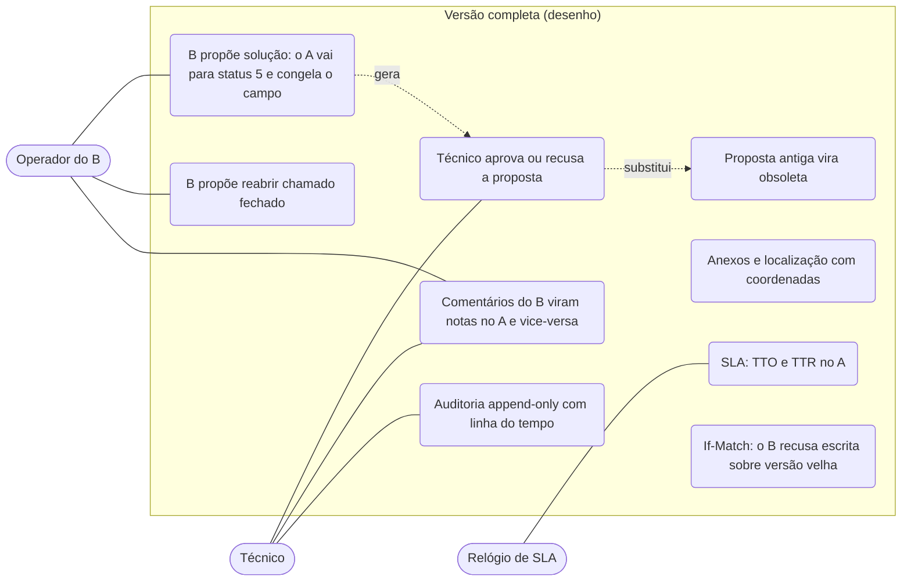

# Mapa do projeto

O escopo, quem usa cada sistema e o que cada um faz hoje, comparado com a versão completa que ficou desenhada. Os diagramas de sequência e de estados estão em [`architecture.md`](architecture.md); o caminho pelo código está em [`how-it-works.md`](how-it-works.md); o histórico de como se chegou aqui está em [`historico.md`](historico.md); as siglas e termos estão no [`glossario.md`](glossario.md).

## Escopo

| | O que é | Situação |
|---|---|---|
| **Obrigatório (PDF)** | Todo chamado criado ou atualizado no A aparece e fica atualizado no B, sem duplicata, sem atualização perdida e sem dado velho sobre novo, com o B lento e com erros | Entregue e provado por 14 E2E sob caos |
| **Obrigatório (entrega)** | Repositório com histórico, documentação, projeto publicado numa URL, lista do que ficou de fora, horas | Entregue |
| **Opcional do avaliador** | B → A: status, quem alterou, solução, fechamento e reabertura, mostrando o anti-eco e a concorrência | Entregue em versão leve, sem aprovação ([ADR-014](adr/014-b-para-a-leve.md)) |
| **Além do pedido** | Exclusão nos dois lados ([ADR-015](adr/015-exclusao-nos-dois-lados-e-o-mestre.md)), A com cara de GLPI, dashboard com caos, deploy automático, reconciliação pelo marcador | Entregue |
| **Fora** | Aprovação do Técnico, notas nos dois sentidos, anexos, SLA, auditoria append-only, alta disponibilidade | Desenho em [`out-of-scope.md`](out-of-scope.md) e nos ADRs |

## Mapa mental

## Atores

| Ator | Onde | Quem é |
|---|---|---|
| **Técnico** | UI e API do A | Quem atende o chamado. Cria, edita, atribui, soluciona, fecha, reabre, exclui e restaura |
| **Estagiário** | UI e API do A | Abre chamados e acompanha; não edita (403) |
| **Operador do B** | UI do B | Pessoa do terceiro. Muda o estado (resolver, fechar, reabrir) e exclui. Toda conta do B é de administrador |
| **Operador do sync** | Dashboard | Quem cuida da integração: acompanha fila e DLQ, reprocessa e liga o caos na demo |
| **Sync Service** | Entre A e B | Ator de sistema: recebe sinais do A, escreve no B e traz de volta o que o operador do B mudou |
| **Relógio** | Sync | Dispara o poller do A e a varredura do B |

## Casos de uso hoje

| Caso de uso | Ator | O que acontece no outro sistema | Prova |
|---|---|---|---|
| Criar chamado | Técnico, Estagiário | O registro aparece no B uma vez, com o marcador `⟦s:glpi-<id>⟧` no fim da descrição | E2E `00`, `a1`, `a2` |
| Editar campos, atribuir, mudar status | Técnico | O B fica com a última versão, mesmo com eventos fora de ordem ou 20 edições seguidas | E2E `b6`, `c1`, `g1` |
| Solucionar e fechar | Técnico | O B fica `RESOLVED` e `CLOSED` no mesmo registro | E2E `g1`, `g2` |
| Reabrir | Técnico | O B volta a aberto e as datas de solução são limpas | E2E `g2` |
| Excluir e restaurar | Técnico | Excluir apaga no B (lápide); restaurar recria, sem duplicar | E2E `h1` |
| Escrever nota | Técnico | Fica só no A (notas não vão ao B) | — |
| Resolver, fechar ou reabrir no B | Operador do B | Em até 30 s o A muda o status e ganha uma nota com quem alterou e a solução; nada volta ao B | E2E `f4` |
| Editar outro campo no B | Operador do B | O A restaura o valor no B e registra uma nota | Integração `b-to-a` |
| Excluir no B | Operador do B | O chamado vai para a lixeira do A com nota, a não ser que o A tenha mudado depois (o A vence) | E2E `h1` |
| A e B mudam o mesmo chamado ao mesmo tempo | Técnico e Operador do B | O A vence e a conversa registra o que o B tinha feito | Integração `b-to-a`; [ADR-011](adr/011-concorrencia-a-x-b.md) |
| Acompanhar e reprocessar | Operador do sync | Reprocessar cria um job novo que relê o A | Integração `dashboard`, `scenarios` (B10) |
| Ligar o caos | Operador do sync | O B passa a falhar como configurado; a fila segura e drena quando desliga | E2E `b1`, `e4` |
| Banco do sync perdido | Sync (na subida) | Os registros com marcador são adotados; nada é criado de novo | Integração `reconcile` |

## Quem manda em cada mudança

| Mudança | Quem manda | Por quê |
|---|---|---|
| Criar e editar campos | **A** | É a fonte da verdade (PDF) |
| Status | Quem mudou desde a última sincronização; se os dois mudaram, o **A** | O B → A leve traz o estado, e a concorrência é decidida a favor do A |
| Quem alterou e solução vindos do B | **B** | Só o B sabe; vira nota no A |
| Excluir | O **A** decide | Excluir no B leva à lixeira do A, que é reversível |

A tabela completa está no [ADR-015](adr/015-exclusao-nos-dois-lados-e-o-mestre.md).

## Como funciona hoje

1. O Técnico salva no A. O A grava e manda um webhook assinado (HMAC) para o sync. O sync grava o evento e responde 200; o webhook é só um sinal.
2. Se o webhook se perder, o poller pede ao A tudo que mudou desde o último checkpoint menos 2 min.
3. Cada chamado tem no máximo um job ativo na fila do Postgres (`SKIP LOCKED` + lease).
4. O worker relê o chamado no A agora (nunca o payload do evento), compara o hash com o último sincronizado e:
   - sem mapeamento, cria no B com o marcador. Se a resposta for ambígua (timeout, 500 depois de gravar), não recria: procura o marcador na listagem;
   - com mapeamento, atualiza o registro e relê o B para confirmar (o B pode dizer 200 sem gravar).
5. Erro transitório volta com backoff por até 24 h; o disjuntor protege o B lento; três recusas permanentes levam à DLQ.
6. A cada 30 s o sync percorre o B. O que mudou e não foi ele que escreveu (`last_written_hash`) vira um job `b_changed`: estado, autor e solução voltam ao A; edição de outros campos é desfeita.
7. Ao subir, antes de liberar o worker, o sync adota pelo marcador todo registro do B que estiver sem mapeamento.

Os diagramas desses passos estão em [`architecture.md`](architecture.md): fluxo A → B, falha ambígua no create, B → A leve, exclusão nos dois lados e os estados do mapeamento.

## Como funcionaria a versão completa

O desenho completo continua nos ADRs 006, 007 e 011 e nas issues que ficaram fora do escopo (M3 e M4). A diferença principal: **o B propõe, o A aprova**.

| Tema | Hoje | Versão completa | Onde está o desenho |
|---|---|---|---|
| Solução vinda do B | Vale direto no A, com nota | Vira proposta; o Técnico aprova ou recusa, e o campo fica congelado até a decisão | [ADR-006](adr/006-b-propoe-a-aprova-congelamento-sla.md), S6.2–S6.4 |
| Reabertura pelo B | Vale direto | Proposta de reabertura | S6.6 |
| Exclusão | Lixeira do A e lápide do B | Exclusão em 2 passos com decisão humana | [ADR-007](adr/007-exclusao-em-2-passos.md), substituído pelo [ADR-015](adr/015-exclusao-nos-dois-lados-e-o-mestre.md) |
| Concorrência | O A vence; o sync relê o B antes de escrever | Também If-Match/ETag, se o B oferecer | [ADR-011](adr/011-concorrencia-a-x-b.md), S6.9 |
| Notas | Só o sync-bot escreve no A; notas não vão ao B | Notas nos dois sentidos, idempotentes por marcador | S7.1, S7.2 |
| Auditoria | `audit_log` técnico e atividade recente no dashboard | Append-only, mascarada, com linha do tempo por chamado | S5.1, S5.2 |
| Operação | Uma VM, um ambiente | Homologação separada, Postgres gerenciado com PITR, réplicas do sync | [`out-of-scope.md`](out-of-scope.md) |
